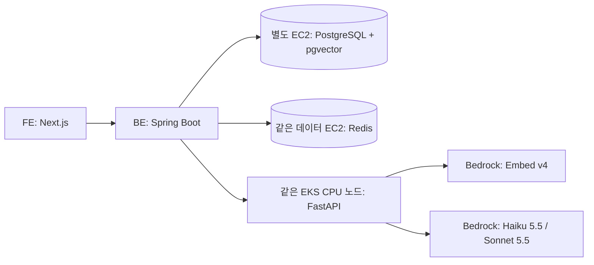

# nerdnam Bedrock 임베딩·LLM 전환 검토

> **모델 선택 전 검토 기록.** 이후 실제 코드는 Nova 2 Lite + Titan V2 1024차원을 채택했다. 현재 배포 기준·변경 상태는 [EKS · GitOps · 관측 구축 계획](EKS-GitOps-관측-구축계획.md)을 따른다. 아래 추천 후보가 현재 사용 모델을 뜻하지는 않는다.

검토일: 2026-10-27, 한국 시간. 모델 선정과 전환 범위를 검토한 문서이며 유료 모델 호출·성능 실측·코드 전환은 수행하지 않았다.

## 1. 추천

해외 리전에서의 데이터 처리가 허용되는 경우 **Cohere Embed v4, float 1024차원 + Claude Haiku 5.5**를 우선 평가한다. 어려운 재구성·작성 방향 작업에서 Haiku가 품질 기준에 못 미치면 해당 기능만 Sonnet 5.5로 올린다. 처음부터 모든 요청을 Sonnet으로 처리하지 않는다.

서울 내 처리만 허용된다면 이 조합을 그대로 채택할 수 없다. 임베딩은 서울 In-Region의 Titan Text Embeddings V2가 후보지만, LLM도 별도로 서울 In-Region을 지원하는 모델을 찾아 품질을 비교해야 한다. 서울 API endpoint를 호출한다는 사실과 서울에서 추론한다는 사실은 다르다.

실제 프로젝트의 한국어 검색·판정 성능은 아직 비교하지 않았다. 아래 추천은 공식 가격·기능·리전 지원과 코드 구조를 근거로 한 후보 선정이다.

## 2. 현재 코드가 요구하는 것

- 임베딩: `google/embeddinggemma-2`, 768차원, 문서·질의용 접두어 구분, 정규화된 벡터. `AI-nerdnam/app/config.py`, `app/embedding.py`.
- 저장소: PostgreSQL `rag.chunk.embedding`은 `vector(768)`. 벡터 검색과 키워드 검색을 결합하고 사용자별로 필터링한다. `BE-nerdnam/src/main/resources/db/migration/V1__init_schema.sql`, `rag/application/ChunkSearch.java`.
- LLM: Qwen3.5-4B를 vLLM OpenAI 호환 endpoint로 호출. JSON Schema·Pydantic 검증·인용 ID 및 수치 검증 후 필요 시 1회 재생성한다. `AI-nerdnam/app/llm.py`.
- P2는 기술 추출과 약어 추출을 별도로 동시에 호출한다. P3는 후보가 있는 요건마다 개별 호출한다. 작성 방향은 탭마다 호출한다.
- 예를 들어 후보가 있는 공고 요건 10개에 대해 프로젝트 재구성 1회·요건 추출 2회·판정 10회·갭 가이드 1회·작성 방향 5회를 모두 수행하면 LLM 요청은 19회다. 재시도·피드백 수정·재분석은 추가 호출이다.
- 응답 시간 목표: 재구성 15초, 리포트 20초, 작성 방향 전체 60초. 토큰 생성 속도뿐 아니라 여러 API를 연결한 전체 시간이 중요하다.

## 3. 임베딩 모델 비교

단가는 USD / 입력 100만 토큰. 출력 임베딩에는 LLM식 출력 토큰 요금이 붙지 않는다. AWS 요금표와 그 페이지가 참조하는 공식 가격 JSON을 대조했다.

| 모델 | 입력 단가 | 출력 차원 | 장점 | 이번 프로젝트의 판단 |
| --- | --- | --- | --- | --- |
| Cohere Embed v4 | $0.12 | 256 / 512 / 1024 / 1536 | 한국어 포함 다국어, 문서·질의 구분, 긴 문맥 지원 | 우선 평가 후보. 1024차원부터 1536과 검색 품질 비교 |
| Titan Text Embeddings V2 | 서울 $0.024592 | 256 / 512 / 1024 | 매우 낮은 단가, 서울 In-Region | 국내 처리·최저 비용 대안. 영어 최적화 모델이므로 한국어·영문 기술명 혼합 질의 실측 필요 |
| Cohere Embed Multilingual v3 | 도쿄 $0.10 | 1024 | 한국어 지원, 기존 다국어 모델 | 입력 문맥 512토큰 제약과 v4 대비 작은 가격 차이 때문에 신규 도입의 우선순위는 낮음 |

Embed v4는 텍스트만 입력해도 사용 가능하다. 지원 차원에 768은 없으므로 현재 스키마를 그대로 유지할 수 없다. 차원을 줄이면 저장량·검색 연산량은 줄지만 같은 입력 토큰의 API 요금은 줄지 않는다.

임베딩 1천만 토큰을 처리하면 v4는 $1.20, Titan V2 서울은 약 $0.246이다. 이 규모에서는 약 $0.954 차이이므로, 국외 처리 제약이 없다면 실제 한국어 검색에서 더 좋은 모델을 고르는 편이 중요하다. v4가 이 프로젝트에서 더 좋다는 실측 결과가 나온 것은 아니다.

Nova Multimodal Embeddings는 미국 In-Region 중심이고 현재 서비스에 이미지·영상 검색이 필요하지 않아 최종 후보에서 제외한다. Cohere Embed 5는 공급사에서 발표했지만 공식 배포 안내에 Cohere API·SageMaker 등이 나와 있으며, 이번에 확인한 Bedrock 관리형 모델 목록에는 없어 Bedrock 후보로 확정하지 않는다.

근거: [AWS 가격](https://aws.amazon.com/bedrock/pricing/), [Cohere v4 파라미터](https://docs.aws.amazon.com/bedrock/latest/userguide/model-parameters-embed-v4.html), [Cohere 다국어 설명](https://docs.cohere.com/v1/docs/embeddings), [Titan 설명](https://docs.aws.amazon.com/bedrock/latest/userguide/titan-embedding-models.html), [Embed 5 배포 안내](https://docs.cohere.com/changelog/embed-v5).

## 4. LLM 비교

USD / 100만 토큰. 서울을 호출 시작 리전으로 하는 Standard 단가다. 모델에 따라 Global 또는 Geo 프로필을 사용한다. Haiku 5.5는 입력 100K 토큰 이하 가격이며, 초과 시 입력 $0.50 / 출력 $2.50로 바뀐다. 세금·캐싱·할인·재시도 비용은 포함하지 않았다.

| 모델 | 입력 | 출력 | 경로 | 이번 프로젝트에서의 용도 |
| --- | --- | --- | --- | --- |
| Nova Micro | $0.041 | $0.164 | Geo | 가장 싼 추출·분류 비교군. 복잡한 한국어 판정·재구성은 별도 품질 검증 |
| Nova Lite | $0.071 | $0.284 | Geo | 저비용 비교군. 이미지 입력은 현재 필요하지 않음 |
| Claude Haiku 5.5 | $0.10 | $0.50 | Global | 기본 모델 우선 후보. 반복 추출·요건 판정·요약에 맞는 효율형, structured outputs 지원 |
| Nova 2 Lite | $0.36 | $2.96 | Global | 최신 Nova 비교군. 서울 단가로는 Haiku 5.5보다 비싸므로 실제 품질 이득이 있어야 채택 |
| Claude Sonnet 5.5 | $2.00 | $10.00 | Global | 재구성·작성 방향의 상위 품질 비교군. 기본 Haiku 대비 양쪽 단가 20배 |

Haiku 5.5는 2026-10-07 출시 모델이다. 이전 Haiku 4.5의 Global 단가 $1 / $5를 기준으로 비용을 잡으면 최신 후보를 놓치게 된다. Sonnet 4.6의 $3 / $15 역시 비교 기준으로는 남길 수 있지만 신규 기본 후보는 Sonnet 5.5로 잡는다.

이 표는 한국어 품질 순위가 아니다. 공급사 일반 벤치마크가 이력서 사실 보존·보수적 판정·인용 정확도를 증명하지는 않는다. Nova가 더 싼 작업에서는 Nova를, Sonnet이 확실히 좋은 작업에서는 Sonnet을 고르되 실제 평가 후 기능별로 고정한다. 모델이 스스로 말하는 자신감으로 자동 승격하지 않는다.

Haiku 5.5는 adaptive thinking이 기본 활성화되어 있으므로 첫 비용·속도 비교는 thinking을 끈 조건을 포함한다. 현재 temperature=0·top_p·top_k·enable_thinking 설정을 새 모델에 그대로 복사하지 않고 Bedrock 모델별 지원 파라미터에 맞춘다.

근거: [AWS 가격](https://aws.amazon.com/bedrock/pricing/), [Haiku 5.5 모델 카드](https://docs.aws.amazon.com/bedrock/latest/userguide/model-card-anthropic-claude-haiku-5-5.html), [Sonnet 5.5 모델 카드](https://docs.aws.amazon.com/bedrock/latest/userguide/model-card-anthropic-claude-sonnet-5-5.html), [structured outputs](https://docs.aws.amazon.com/bedrock/latest/userguide/structured-output.html).

## 5. 예상 이용 비용

비교용 가정: 프로젝트 재구성·공고 분석·작성 방향 5개 탭까지 한 흐름의 **모든 호출을 합해 입력 60,000·출력 10,000토큰**. 모델별 토크나이저가 달라 같은 한국어도 실제 토큰 수는 달라진다. 이 수치는 실측값이 아니며 반복 생성·오류 재시도·reasoning·캐시 기록 요금을 포함하지 않는다.

| 모든 호출을 같은 모델로 처리 | 흐름 1회 | 흐름 1,000회 | 흐름 10,000회 |
| --- | --- | --- | --- |
| Nova Micro | $0.0041 | $4.10 | $41 |
| Nova Lite | $0.0071 | $7.10 | $71 |
| Haiku 5.5 | $0.011 | $11 | $110 |
| Nova 2 Lite | $0.0512 | $51.20 | $512 |
| Sonnet 5.5 | $0.22 | $220 | $2,200 |

계산식: 입력 토큰 / 1,000,000 × 입력 단가 + 출력 토큰 / 1,000,000 × 출력 단가.

처리 토큰량의 90%를 Haiku, 10%를 Sonnet에 배정하고 두 모델에 중복 호출하지 않는 단순 가정이면 1,000회당 약 $31.90이다. 실패한 Haiku 뒤 Sonnet으로 재시도하면 최초 호출 비용도 더해진다. 작성 방향은 출력이 길어 토큰 비중이 커질 수 있으므로 호출 횟수 10%와 토큰량 10%는 다르다.

월 사용량은 단순 가입자 수나 MAU가 아니라 사용자당 분석 수·요건 수·작성 탭 수·재시도 수로 추정한다. 초기에는 Provisioned Throughput 없이 온디맨드로 시작하고 endpoint·회원·작업 종류별 사용 토큰과 비용을 기록한다. 캐시·Batch 할인은 모델·리전·최소 토큰·TTL 지원을 확인한 뒤 적용하며 실시간 사용자 요청을 Batch 완료까지 기다리게 하지 않는다.

숫자 검증 근거는 `Bedrock-요금-확인-2026-10-27.json`에 가격 키와 rate code로 남겼다. 공개 데이터 원본: [Bedrock 가격 JSON](https://b0.p.awsstatic.com/pricing/2.0/meteredUnitMaps/bedrock/USD/current/bedrock.json), [외부 공급사 모델 가격 JSON](https://b0.p.awsstatic.com/pricing/2.0/meteredUnitMaps/bedrockfoundationmodels/USD/current/bedrockfoundationmodels.json). JSON 단위에 페이지의 배수를 적용한 값이다. 새 견적에서는 다시 조회한다.

## 6. 리전·데이터 처리 조건

| 모델 | 서울에서 호출 시 | 대안 |
| --- | --- | --- |
| Cohere Embed v4 | Global 지원, 서울 In-Region·Geo 미지원 | 도쿄 In-Region은 가능하지만 국내 처리는 아님 |
| Titan Text Embeddings V2 | 서울 In-Region 지원 | 국내 처리 임베딩 후보 |
| Haiku 5.5 / Sonnet 5.5 | 서울에서는 Global 지원 | 일본 Geo 등을 원하면 해당 프로필·시작 리전·가격을 별도로 검토 |
| Nova Micro / Lite | 서울 Geo 지원, 서울 In-Region 미지원 | APAC 내 처리가 한국 내 처리와 같지는 않음 |
| Nova 2 Lite | 서울 Global 지원 | 현재 서울 가격표에 Geo 가격이 없으므로 다른 리전 가격을 서울 가격으로 적용하지 않음 |

Global은 추론이 세계의 지원 리전에서 이루어질 수 있다. 실제 허용 처리 지역은 배포 직전 GetInferenceProfile과 IAM·조직 정책을 대조한다. 원래 기획의 자체 GPU·외부 LLM 미사용 전제는 Bedrock 전환에 맞춰 갱신해야 한다. 이력·경력 원문에서 식별정보를 제거하는 BE-17은 여전히 필요하다.

Bedrock의 보관 정책은 모델과 계정·프로젝트 설정에 따라 다르므로 모든 모델이 무조건 무보관이라고 가정하지 않는다. 데이터 retention 설정과 호출 로그에 원문을 남기는지 확인한다. 보관 정책·처리 지역에 대한 결정 없이 실제 이력 데이터를 Global에 보내는 단계를 완료 처리하지 않는다.

근거: [모델별 리전 지원](https://docs.aws.amazon.com/bedrock/latest/userguide/models-region-compatibility.html), [Global 처리](https://docs.aws.amazon.com/bedrock/latest/userguide/global-cross-region-inference.html), [프로필 확인](https://docs.aws.amazon.com/bedrock/latest/userguide/inference-profiles-support.html), [보관 정책](https://docs.aws.amazon.com/bedrock/latest/userguide/data-retention.html).

## 7. 권장 전환 구조

첫 전환에서는 FastAPI를 유지해 프롬프트·검증·BE↔AI API 계약을 재사용한다. torch·sentence-transformers·vLLM은 운영 이미지에서 제거하고 CPU용 경량 이미지로 바꾼다. AI Pod는 FE·BE와 같은 CPU 노드에서 실행한다. 모델 호출을 Java로 옮기는 일은 필수 전환 범위가 아니다.

이 구성이 되면 GPU EC2·GPU 노드 그룹·NVIDIA 플러그인·모델 캐시 EBS를 제거할 수 있어 EC2는 앱용 CPU 1대와 데이터용 CPU 1대, 총 2대가 된다. EKS·NLB·NAT·DB 비용까지 모두 없어지는 것은 아니다. 특히 private 데이터 EC2의 업데이트·이미지 다운로드 경로는 계속 필요하다. Bedrock용 VPC endpoint 도입 여부는 NAT 사용량과 endpoint 고정비를 비교해 정한다.

## 8. 필요한 변경

1. **AI 호출 어댑터:** LLM은 bedrock-runtime Converse 또는 InvokeModel, 임베딩은 InvokeModel 기반 어댑터를 만든다. vLLM 전용 OpenAI 요청 몸통을 그대로 보내지 않는다. Global 프로필 ID 후보는 `global.anthropic.claude-haiku-5-5`, `global.anthropic.claude-sonnet-5-5`, `global.cohere.embed-v4:0`이다.
2. **검증 유지:** JSON Schema 형식 보장과 내용 검증을 분리한다. structured outputs가 있어도 원문에 없는 수치·근거 ID·수정 요청 반영 여부는 기존 검증기로 검사한다. 현재 인용 ID는 앱 JSON 필드이며 Bedrock 내장 citations 기능과는 다르다.
3. **임베딩 규칙:** Cohere는 문서 `search_document`, 질의 `search_query`를 사용한다. embeddinggemma 전용 접두어를 그대로 사용하지 않는다. 제목 포함 규칙·정규화·차원을 고정하고 `embedding_model`에 공급사·모델·차원을 기록한다.
4. **DB 마이그레이션:** `vector(768)`에서 선택한 1024 또는 1536차원으로 새 Flyway 마이그레이션을 추가한다. 적용된 V1은 수정하지 않는다. 기존 벡터의 단순 형 변환으로 해결할 수 없으며 새 공간에서 전부 다시 생성해야 한다. 같은 차원이어도 다른 모델의 벡터를 섞으면 안 된다.
5. **전환 중 검색:** 현재 검색 SQL은 READY만 검사하고 모델 ID로 필터링하지 않는다. 기존·신규 벡터를 나누는 컬럼·테이블 또는 일괄 재생성 기간의 검색 중단 정책을 정한다. 새 벡터가 준비된 뒤 질의·문서를 함께 전환한다. 사용자별 격리는 유지한다.
6. **헬스·오류 처리:** 로컬 모델 로딩·GPU 꺼짐 중심 상태를 원격 API 인증·접근 가능 여부·429·timeout·서비스 오류 중심으로 바꾼다. BE·FE 계약의 GPU_UNAVAILABLE 문구·코드도 대조한다. 헬스 점검을 위해 유료 생성을 주기적으로 실행하지 않는다.
7. **권한·부하:** AI Pod에만 최소 Bedrock 호출 권한을 Pod Identity 등으로 준다. 비밀 Access Key를 이미지에 넣지 않는다. 요건별 무제한 gather를 제한된 동시성·계정별 RPM/TPM·재시도 예산과 함께 관리한다. 기존 앱 검증 재생성과 SDK 재시도가 중첩되지 않게 기록한다.
8. **문서·인프라:** 모델 선택이 정해지면 SPEC ADR-0001·0005·기획서·계약 복사본과 EKS 배포 계획을 갱신한다. 이번 검토만으로 기존 코드를 전환하거나 GPU 리소스를 삭제하지 않았다.

## 9. 평가 순서와 채택 기준

1. 식별정보를 제거한 기존 `evals/embed_cases.json`, `search_cases.json`으로 Embed v4 1024·1536과 Titan V2 1024를 비교한다. 현재 embeddinggemma 결과와 검색 Hit@1·MRR·하이브리드 후보 Recall@20을 대조한다. 평가 스크립트의 로컬 모델 직접 로딩 부분은 원격 어댑터로 확장해야 한다.
2. 같은 후보 청크와 입력으로 Haiku 5.5·Sonnet 5.5·Nova Micro를 비교한다. `match_cases.json`, `revise_cases.json`, 추출 평가 세트와 SPEC fixtures를 활용한다. 프롬프트를 바꾸면 모델명·프롬프트 버전·옵션을 함께 기록한다.
3. 판정 정확도 목표 85%, 인용 근거 정확도 목표 98%, 원문에 없는 수치와 과대 충족 판정, 사례 수정 요청 반영을 함께 본다. 모델 선택에서 JSON 성공률만 통과 기준으로 쓰지 않는다.
4. 개별 호출과 전체 이용 흐름의 p50·p95, 성공률·429·재시도율·실제 토큰·실제 비용을 측정한다. 현재 목표 15초·20초·60초와 비교하고 사용자 동시 요청을 늘려 반복한다. 외부 API를 쓴다는 이유만으로 지연 목표 달성을 단정하지 않는다.
5. 처음에는 Haiku 하나로 기능을 검증한 뒤 품질이 부족한 기능만 Sonnet을 채택한다. 임베딩은 모든 후보에 대해 별도 문서·질의 벡터를 생성해 평가하고 검증 전 운영 벡터를 덮어쓰지 않는다.

AWS 계정의 모델 접근·실제 쿼터, 한국어 품질·속도, 월 사용량은 아직 확인하지 않았다. 현 단계의 권장안은 **해외 처리 허용 시 Embed v4 + Haiku 5.5, 필요한 기능만 Sonnet 5.5**다.
