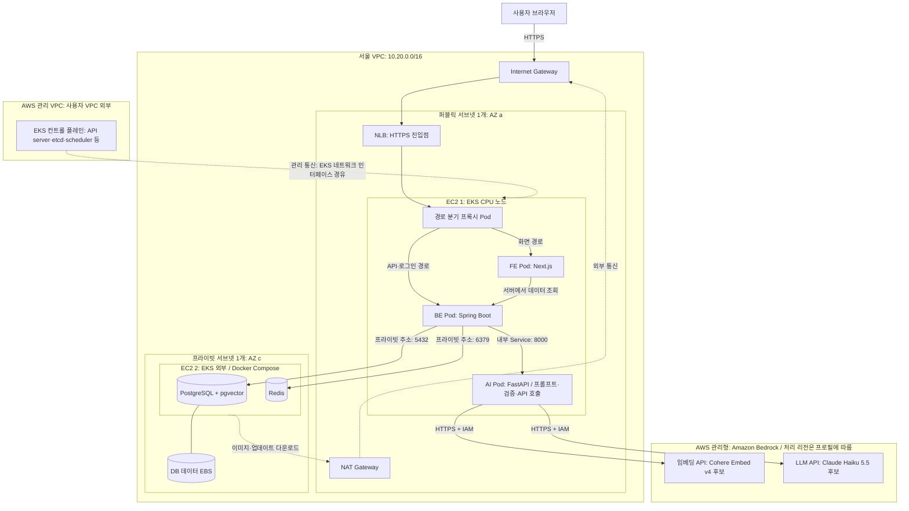

# Bedrock 전환 후 인프라 구성도

> **이전 설계 기록.** 현재 계획은 [EKS · GitOps · 관측 구축 계획](EKS-GitOps-관측-구축계획.md)을 따른다. 2026-10-28에는 app/platform/data EC2 3대를 모두 동일 EKS 워커로 두기로 합의했다. 아래 EKS 외부 데이터 서버 그림·후보 모델·전환 미완료 설명은 당시 검토 내용이다.

2026-10-27 기준 설계안. EC2는 앱용 CPU 1대와 데이터용 CPU 1대, 총 2대다. GPU·vLLM·로컬 임베딩 모델은 운영 구성에서 제거한다. FE는 EC2에 배포하고 DB·Redis는 앱 서버와 분리한다. 자동 확장은 사용하지 않는다. Bedrock 모델은 검토 문서의 추천 후보이며 처리 리전 조건과 실제 평가 후 확정한다.

## 요청 흐름

1. 사용자는 하나의 공개 HTTPS 주소로 접속한다. NLB는 앱 EC2의 프록시로 전달한다.
2. 프록시는 화면 요청을 Next.js로, `/api/*`·`/oauth2/*`·`/login/oauth2/*`를 Spring Boot로 전달한다.
3. BE는 데이터 EC2의 프라이빗 주소로 PostgreSQL·Redis에 접속한다. 두 데이터 포트는 인터넷에 공개하지 않는다.
4. AI 기능을 실행하면 BE가 내부 FastAPI를 호출한다. FastAPI가 프롬프트 구성·Bedrock 호출·결과 검증을 담당한다.
5. 임베딩 결과는 BE가 기존 pgvector에 저장하고 검색한다. Bedrock Knowledge Bases나 별도 벡터 DB는 추가하지 않는다.

## 관리 범위

| 구성 | 관리 방식 |
| --- | --- |
| FE·BE·AI·프록시 | 앱 EC2 한 대 위의 EKS Pod. CPU Managed Node Group 목표 1대 |
| PostgreSQL·Redis | EKS 외부의 데이터 EC2 한 대에서 Compose로 실행 |
| EKS 컨트롤 플레인 | AWS 관리. 별도 사용자 EC2로 세지 않음 |
| 모델 추론 인프라 | Bedrock 관리. 사용자 GPU EC2 없음 |
| AWS 리소스 | Terraform: VPC·서브넷·IGW·NAT·EKS·EC2·EBS·IAM·ECR 등 |
| 이미지 배포 | ECR web / api / ai, 앱 배포 정의는 INFRA 저장소 |
| 비밀값·로그·상태 저장 | Secrets Manager 등 비밀값 공급, CloudWatch, 기존 Terraform S3 backend |

## 컨트롤 플레인 위치

EKS를 유지하므로 컨트롤 플레인은 AWS가 관리하는 별도 VPC에 둔다. 사용자가 컨트롤 플레인용 EC2를 만들거나 public-a·private-c 중 설치 위치를 고르지 않는다. 사용자 VPC에 생성되는 EKS 네트워크 인터페이스를 통해 워커 노드와 통신한다. 앱용 EC2는 워커 역할만 하며 데이터 EC2는 EKS 외부에 남는다.

초기 관리 접속은 private endpoint를 활성화하고 public endpoint는 팀원 공인 IP로 제한하는 안을 사용한다. 컨트롤 플레인의 실제 배치와 API endpoint의 접근 허용 범위는 서로 다른 설정이다. 추가 사용자 EC2는 없지만 EKS 클러스터 요금은 별도다.

근거: [AWS EKS 네트워크 구조](https://docs.aws.amazon.com/eks/latest/best-practices/subnets.html), [EKS API 접근 설정](https://docs.aws.amazon.com/eks/latest/userguide/cluster-endpoint.html).

## 네트워크와 전환 시 확인할 것

- 퍼블릭·프라이빗은 서로 다른 AZ에 둔다. EKS 클러스터 네트워크에는 두 서브넷을 등록하고 앱 노드 그룹은 public-a만 사용한다.
- 단일 퍼블릭 서브넷 조건을 유지하므로 NLB와 앱 노드를 같은 AZ에 배치한다. NLB가 경로 분기를 하지 않으므로 CPU 노드의 프록시가 담당한다.
- 데이터 EC2는 퍼블릭 IP 없이 운영한다. NAT는 데이터 EC2의 외부 다운로드·업데이트 경로로 남는다. Bedrock 호출은 public-a의 앱 노드에서 이루어진다.
- Bedrock용 VPC endpoint는 현재 필수 구성에 넣지 않고 고정비·통신 정책을 비교해 별도 결정한다.
- 앱 EC2와 데이터 EC2가 다른 AZ이므로 BE↔DB·Redis의 AZ 간 전송 비용을 반영한다.
- GPU 노드 그룹·NVIDIA device plugin·모델 캐시 EBS는 제외한다. 현재 코드를 Bedrock으로 바꾸고 임베딩 차원 변경·전체 재생성을 완료해야 이 구성으로 동작한다.
- Bedrock 후보 모델의 Global 프로필은 서울 내 추론을 보장하지 않는다. 모델·처리 지역·보관 정책을 함께 확정한다.
- 기존 EKS·NLB·NAT 비용은 남으며, 앱·데이터 EC2는 각각 한 대이므로 고가용성 구성은 아니다.

관련 검토: [Bedrock 모델·비용 검토](Bedrock-모델-검토.md). 이 문서는 계획이며 AWS 리소스를 생성하거나 애플리케이션 코드를 변경한 결과가 아니다.
