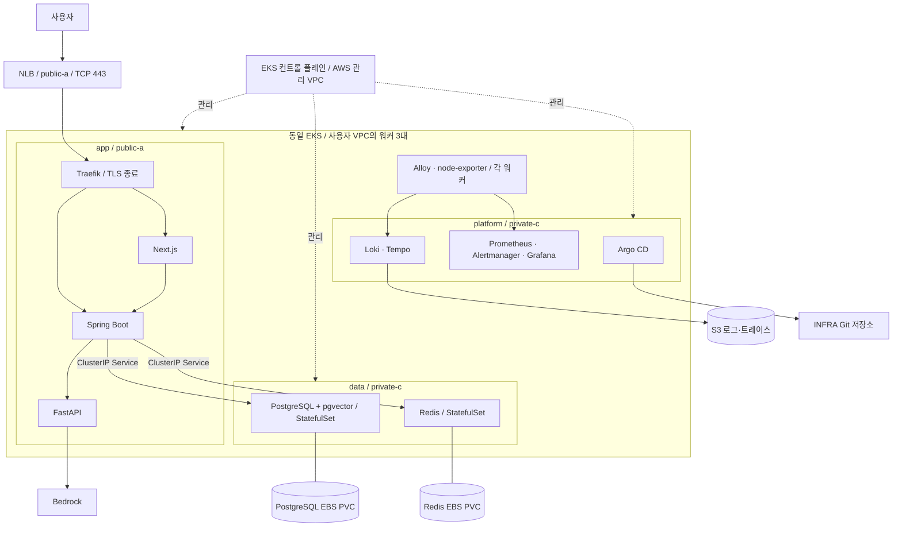
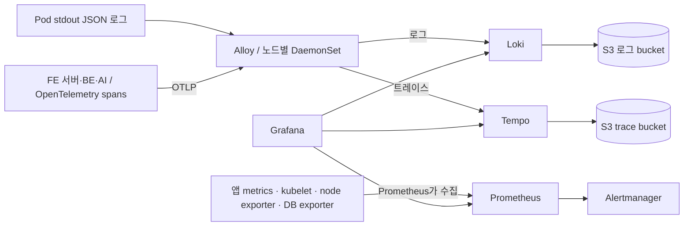

# Bedrock 전환 이후 EKS · Terraform · GitOps · 관측 구축 계획

작성일: 2026-10-27. 개정일: 2026-10-28. **앱·운영 도구·데이터용 EC2 3대를 모두 동일 EKS의 워커로 운영**하도록 사용자 합의를 반영했다. 초기 소규모 배포 계획이다. AWS 리소스를 생성하거나 애플리케이션을 수정한 결과가 아니다. 이전 GPU 배포 계획과 Bedrock 후보 모델 추천보다 이 문서의 현재 코드 기준을 우선한다.

> 2026-10-28 범위 변경: PostgreSQL 일일 S3 백업과 새 PVC 복원 시험은 사용자 요청으로 후속 작업으로 미룬다. 백업 bucket·CronJob·IAM·snapshot 추가도 초기 구축에 포함하지 않는다. 현재는 PVC 영속성/보존과 Pod 재시작 후 데이터 유지까지만 검증한다. 단계별 구현·검증 후 커밋한다.

> 진행 상태: VPC·EKS 코드를 작성했고 현재는 코드 검토·검증을 계속하는 단계다. 실제 AWS 배포나 사용자 apply는 후속 코드 작성의 선행 조건이 아니다. AWS 변경은 실행하지 않는다. VPC는 이전 적용 후 삭제됐고 EKS는 미배포다. [EKS 코드 작업계획](EKS-기반-작업계획.md), [VPC 이력](VPC-단계-작업기록.md)을 따른다.

## 1. 검토 범위와 확인한 변화

| 저장소 | 검토 기준 | 확인한 내용 |
| --- | --- | --- |
| SPEC | 10/27 `a0fea0e`, 10/28 로컬 main `edb82c4` 확인 | 기획서 v1.64, C-04 v0.4.0. 추가 변경은 guide usage fixture |
| AI | 로컬 `df3e23e`, 원격 main `416e528`도 직접 읽음 | Nova 2 Lite + Titan V2, CPU 전용 Dockerfile, 요청별 LLM usage. 원격 최신 `/match`는 p3_v4, 최대 10개 묶음 |
| BE | 10/28 로컬 main `24c38d8` 확인 | V6 1024차원 전환, 긴 AI 타임아웃, AI 작업 큐. 토큰 기록·V8·관련 테스트가 PR #41로 병합됨 |
| FE | main `42e2946` | Next.js 16.4.2, Node 24 standalone 이미지, SSR·쿠키 전달, 빌드 시 API_ORIGIN 필요 |
| INFRA | main `73ce3f3` + 기존 계획 문서 | S3 backend·provider 초기화만 구현. VPC/EKS/배포 매니페스트 없음 |

10/27에는 원격을 fetch해 코드 전반을 검토했다. 10/28에는 로컬 상태와 BE·SPEC 추가 커밋을 확인했으며 원격 전체 재검토는 하지 않았다. AI 로컬 main은 자동으로 당기지 않았다. 소스 병합과 운영 배포 완료는 구분하며 구현 시작 시 배포 commit을 다시 고정한다.

핵심 코드 근거:

- AI: `app/config.py`, `app/llm.py`, `app/embedding.py`, `app/main.py`, `app/schemas.py`, 원격 main의 `app/routers/match.py`.
- BE: `application.yml`, `AiJobConfig.java`, `AiJobs.java`, `ChunkEmbedder.java`, `ChunkSearch.java`, `V6__embedding_1024.sql`, main의 `V8__ai_call_log_usage.sql`·`RecordingAiServerClient.java`.
- FE: `Dockerfile`, `next.config.ts`, `src/shared/api/origin.ts`, `src/shared/api/server.ts`.
- CI: BE `.github/workflows/test.yml`은 테스트만 실행한다. 검토 시점 FE·AI·INFRA에는 `.github/workflows`가 없다.

### 현재 모델과 역할

- LLM: `global.amazon.nova-2-lite-v1:0`, Bedrock Converse API.
- 임베딩: `amazon.titan-embed-text-v2:0`, 정규화된 1024차원, InvokeModel API.
- FastAPI는 프롬프트 작성·출력 검증·토큰 합산·Bedrock 연결을 맡으므로 계속 배포한다. GPU는 필요 없다.
- PostgreSQL + pgvector 검색을 유지한다. Bedrock Knowledge Bases 도입은 이 계획의 전제가 아니다.
- LLM의 Global 프로필은 서울 내 처리를 보장하지 않는다. IAM/SCP와 서비스의 데이터 처리 정책을 실제 선택 프로필에 맞춘다.

SPEC의 측정 결과는 프로젝트가 기록한 결과이며 이번 검토에서 재실행하지 않았다. p3_v4 판정 일치율 89%와 묶음 호출 개선을 참고하되, 부하·비용은 배포 대상 이미지로 다시 측정한다. ADR-0007 상단의 상태는 여전히 ‘제안’이므로 실제 구현을 반영해 정리할 필요가 있다.

## 2. 확정 방향: 동일 EKS에 역할별 워커 3대

**AWS 관리형 EKS 컨트롤 플레인 + app/platform/data Managed Node Group 각 1대.** PostgreSQL·Redis도 데이터 워커의 Kubernetes Pod로 배포한다. EKS 외부 Compose 데이터 서버는 만들지 않는다.

| 노드 그룹 | Pod 배치 | 초기 용량 후보 | 서브넷 |
| --- | --- | --- | --- |
| app | FE·BE·AI·Traefik | x86_64, 4 vCPU / 16 GiB, 1대 | public-a |
| platform | Argo CD·Prometheus·Alertmanager·Grafana·Loki·Tempo 및 운영 controller | x86_64, 4 vCPU / 16 GiB, 1대 | private-c |
| data | PostgreSQL 17+pgvector·Redis 7.4·exporter | x86_64, 2 vCPU / 8 GiB, 1대 | private-c |

각 그룹은 `min=desired=max=1`, 앱·DB·Redis는 각각 replica 1로 시작한다. HPA·Karpenter·Cluster Autoscaler는 설치하지 않는다. 용량은 실측 전 후보이며 인스턴스 패밀리·가격은 서울 가용성과 chart requests 합계를 검토해 적용 전에 고정한다. EKS 컨트롤 플레인은 고객 EC2 3대에 포함되지 않고 서비스 요금이 별도다.

### 배치 규칙

- 노드 라벨: `workload=app|platform|data`. 각 workload의 required node affinity 또는 nodeSelector로 역할을 고정한다.
- platform/data에는 각각 `dedicated=platform:NoSchedule`, `dedicated=data:NoSchedule` taint. 해당 Pod만 정확한 toleration을 갖는다. toleration만으로 배치 위치가 고정되지는 않는다.
- app은 초기 bootstrap을 위해 전용 taint 없이 시작하되 모든 업무 Pod에 역할 선택자를 둔다. 임의 Pod 배포 권한은 namespace/RBAC로 제한한다.
- CNI·kube-proxy·Pod Identity·EBS CSI node·Alloy·node-exporter는 필요한 모든 노드에서 실행되게 toleration을 확인한다. CoreDNS는 app/platform에 분산 가능한 설정으로 두고 data는 피한다. 단일 app 장애가 DNS까지 끊지 않도록 검증한다.
- 운영 controller의 leader election·webhook·CoreDNS 배치를 검토한다. 무조건 platform 한 곳에 모든 시스템 Pod를 몰면 platform 장애가 앱 재시작·Secret 갱신에도 영향을 준다.
- Traefik은 NLB와 같은 public-a의 app에 둔다. 관측 대시보드 접근은 초기 port-forward를 사용하므로 app ingress 장애 때도 platform에 접근 가능하다.

근거: [노드 taint와 toleration](https://kubernetes.io/docs/concepts/scheduling-eviction/taint-and-toleration/).

### 운영 한계

앱 노드 장애 시 이미 수집된 관측 자료를 platform에서 볼 수 있고 관측 조회 부하가 앱 자원을 직접 소모하지 않는다. 다만 동일 클러스터·네트워크를 공유하므로 완전히 독립된 장애 감시 시스템은 아니다. 각 역할 1대라 앱·DB 무중단/자동 failover는 보장하지 않는다. 특히 private-c 장애 시 data와 platform이 함께 중단된다.

MNG 업데이트는 교체 EC2를 일시 추가할 수 있다. 정상 운영 목표는 3대이며, 변경 창의 일시 추가 용량은 비용/할당량에 포함한다. 항상 3대 이하가 필수라면 minimal 전략과 중단을 수용해야 한다. 데이터 노드 교체는 별도 점검 절차로 수행한다. [EKS 노드 업데이트](https://docs.aws.amazon.com/eks/latest/userguide/managed-node-update-behavior.html)

## 3. 네트워크와 구성도

퍼블릭 1개·프라이빗 1개 조건을 유지한다. EKS에 등록할 두 서브넷은 반드시 서로 다른 AZ에 둔다. EC2 수와 서브넷 수는 일대일 관계가 아니다. [EKS 네트워크 요구사항](https://docs.aws.amazon.com/eks/latest/userguide/network-reqs.html)

| 리소스 | 배치 |
| --- | --- |
| VPC | `10.20.0.0/16`, 기존 VPC/연결망과 겹침 확인 후 사용 |
| public-a | `10.20.0.0/24`, NLB·app 워커·NAT Gateway |
| private-c | `10.20.16.0/20`, platform·data 워커, 공인 IP 없음 |
| public route | `0.0.0.0/0 → IGW` |
| private route | `0.0.0.0/0 → NAT Gateway` |
| S3 Gateway endpoint | ECR 이미지 레이어·관측 S3 저장 경로에 사용, 두 route table 연결 |
| EKS API endpoint | private 활성화 + public은 팀/관리 실행 환경의 고정 공인 IP로 제한 |



물리 서브넷과 EKS 소속은 별개다. private-c의 두 EC2도 EKS 워커다. platform/data의 Git·ECR API·패키지 등 외부 통신은 public-a NAT→IGW를 사용한다. S3는 Gateway endpoint를 우선 사용한다.

### 공개 진입점

- 한 퍼블릭 서브넷에서 운영 가능한 NLB를 사용하고 NLB와 워커를 같은 AZ에 둔다. ALB 중심 설계로 전환하려면 먼저 퍼블릭 서브넷을 늘린다. [NLB AZ 설정](https://docs.aws.amazon.com/elasticloadbalancing/latest/network/availability-zones.html)
- AWS Load Balancer Controller가 Traefik `Service(type=LoadBalancer)`를 보고 NLB·target group을 생성한다. Terraform에서 같은 NLB를 중복 생성하지 않는다. IP target을 기본 후보로 두고 VPC CNI·노드 SG·대상 health check를 함께 검증한다. [LBC NLB 구성](https://kubernetes-sigs.github.io/aws-load-balancer-controller/latest/guide/service/nlb/)
- NLB는 TCP 443 전달, TLS는 Traefik에서 종료한다. cert-manager + ACME DNS01으로 발급/갱신한다. Route53을 DNS로 사용한다는 설계 가정이며 도메인/zone은 구현 시 입력한다. cert-manager의 DNS 변경 권한은 해당 zone으로 제한한다. [Traefik Ingress](https://doc.traefik.io/traefik/reference/routing-configuration/kubernetes/ingress/), [cert-manager Route53](https://cert-manager.io/docs/configuration/acme/dns01/route53/)
- `/api/*`, `/oauth2/*`, `/login/oauth2/*` → BE, 그 외 화면 경로 → FE. OAuth 콜백도 같은 HTTPS 도메인을 사용한다.
- FE의 서버 측 호출은 `http://api.nerdnam.svc.cluster.local:8080`. `API_ORIGIN`은 이미지 빌드와 실행 양쪽에서 일치시킨다. 환경별로 달라지면 현재 구현에서는 FE 재빌드가 필요하다.
- Traefik의 전달 헤더와 Spring의 HTTPS 인식·Secure 쿠키·리다이렉트를 검증한다. AI·DB·Redis·metrics는 공개 라우트에 넣지 않는다.
- Argo CD·Grafana는 처음에 인증된 관리자의 `kubectl port-forward`로 사용한다. 외부 도메인 노출은 SSO·접근 제한을 구성한 뒤 추가한다.

### 보안 그룹과 통신 경로

- 공개 NLB SG: 서비스 443, 필요하면 HTTPS 리다이렉트용 80만 허용.
- 워커 SG: NLB에서 오는 지정 포트·health check, EKS 관리 통신. EC2 공인 주소의 앱 포트를 직접 열지 않는다.
- 데이터 접근: PostgreSQL·Redis는 ClusterIP만 제공하고 NodePort/LoadBalancer를 만들지 않는다. NetworkPolicy로 BE→DB/Redis, Prometheus→exporter만 허용한다. SG는 EKS/CNI의 노드·Pod 통신 요구를 반영하며 워커 SG만으로 같은 클러스터 Pod 간 접근을 세밀하게 구분했다고 보지 않는다. PostgreSQL 인증과 Redis ACL도 적용한다.
- app 워커의 공인 IPv4·VPC CNI 외부 SNAT 경로를 명시한다. public subnet이라는 이름만으로 Pod의 Bedrock·GitHub·OAuth 외부 호출이 보장되는 것은 아니다.
- platform/data 워커의 외부 통신은 NAT 경유다. 노드 관리가 필요하면 SSM을 사용하고 SSH 22 개방을 기본으로 삼지 않는다. Pod 작업은 Kubernetes API로 수행한다.
- 앱과 데이터가 다른 AZ라 DB·Redis·스크레이프 및 NAT 경로의 AZ 간 비용이 발생할 수 있다. NAT도 단일 장애 지점이다.
- Bedrock VPC endpoint는 별도 비교 항목이다. 추가해도 Global 추론의 처리 지역이 서울로 고정되지 않고 GitHub/OAuth 등 외부 통신 경로도 계속 필요하다.
- NetworkPolicy는 VPC CNI의 정책 지원을 실제 활성화한 뒤 적용한다. DNS·Pod Identity·외부 HTTPS와 BE→AI, BE→데이터, 관측 수집 경로를 명시적으로 허용한다.

## 4. Terraform과 Argo CD의 관리 경계

| 관리 주체 | 소유할 리소스 |
| --- | --- |
| Terraform AWS 계층 | VPC·서브넷·routes·NAT·SG·EKS·MNG·EKS access entries·ECR·S3·IAM·Pod Identity association·노드 Launch Template/root EBS·Secrets Manager 메타데이터·CloudWatch·예산 |
| Terraform EKS add-on | VPC CNI, CoreDNS, kube-proxy, EBS CSI, Pod Identity Agent |
| 별도 bootstrap 단계 | 버전 고정 Argo CD Helm 설치, root Application, Argo 저장소 읽기 자격 증명 공급 |
| Argo CD | 앱·PostgreSQL/Redis StatefulSet·Service·PVC·StorageClass·LBC·Traefik·cert-manager·External Secrets·관측 chart/설정·dashboard·alert rule |
| LBC / EBS CSI | Git에 선언한 Service/PVC를 근거로 생성하는 NLB/target group, 동적 EBS |

같은 Kubernetes 객체나 Helm release를 Terraform과 Argo가 동시에 소유하지 않는다. Argo 자체는 bootstrap이 계속 소유한다. 데이터 워커 EC2는 Terraform/MNG, 그 위의 DB·Redis·PVC 선언은 Argo가 소유한다. PVC에 따라 EBS CSI가 생성한 데이터 EBS를 Terraform에서 다시 관리하지 않는다.

AWS Terraform 루트는 당분간 기존 저장소 루트를 유지하고 `modules/network`부터 추가한다. EKS 생성 이후 bootstrap은 별도 루트/state로 분리한다. `terraform/envs/dev/aws` 등으로 옮기는 작업은 환경이 늘어날 때 별도 변경으로 수행한다. 현재 `dev/terraform.tfstate`는 AWS 계층에 유지하고 bootstrap에는 별도 key를 사용한다. 디렉터리를 옮길 때 state를 지우거나 S3 backend를 재생성하지 않는다. 변경 전 state 백업과 plan 대조가 필요하다.

하나의 apply에서 EKS 생성·Helm provider 초기화·CRD·Custom Resource까지 한꺼번에 처리하지 않는다. bootstrap 실행기는 EKS API에 접근 가능한 관리자 환경을 사용한다. CI가 ECR에 이미지를 올리는 데 Kubernetes API 접근은 필요 없다.

### 저장소 배치 제안

```text
INFRA-nerdnam/
  *.tf                           # 현재 dev AWS 루트, 기존 backend 유지
  modules/network/               # 구현 완료
  modules/{eks,iam,storage}/      # 이후 단계에서 추가
  bootstrap/                     # 이후 Argo 전용 루트/state
  tests/network.tftest.hcl        # 실제 AWS 생성 없는 mock 검증
  gitops/
    applications/                 # root, platform, data, observability, app
    platform/                    # LBC, Traefik, cert-manager, secrets
    observability/               # chart values, dashboards, rules, Alloy
    apps/{web,api,ai}/base/
    apps/{web,api,ai}/overlays/dev/
    data/{postgres,redis}/        # StatefulSet, Service, PVC; backup은 후속
  runbooks/                      # drain, migration, rollback; backup/restore는 후속
  docs/
```

첫 환경은 기존 backend/tag와 맞춰 dev로 둔다. 정식 운영환경은 별도 state·설정·비밀값·접근 권한으로 만들며 dev를 이름만 바꿔 승격하지 않는다.

## 5. 배포 흐름과 IAM

```text
FE / BE / AI 코드 PR
  → 해당 저장소 테스트
  → merge 후 이미지 빌드·검사
  → GitHub Actions OIDC로 ECR push
  → INFRA에 image digest 변경 PR
  → PR merge
  → Argo CD가 감지하고 동기화
  → readiness·실제 기능·관측 데이터 검증
```

- ECR repository는 web/api/ai를 분리하고 불변 태그·이미지 digest를 배포 정의에 고정한다. chart와 add-on도 호환되는 버전을 고정한다.
- FE는 lint/build, AI는 계약·unit test, BE는 기존 Gradle 테스트를 CI에 연결한다. Bedrock 실호출 평가는 일반 PR 테스트와 분리해 호출 비용·한도를 제어한다.
- OIDC trust는 해당 GitHub repo·branch/environment로 제한한다. CI 배포 역할, Terraform 역할, Argo 저장소 읽기 권한을 분리한다. INFRA 변경 PR 작성에는 제한된 GitHub App 등을 사용한다.
- 앱과 관측 config Git 저장소를 분리하는 방식은 Argo 권장 운영 패턴에 부합한다. [Argo GitOps 권장 사항](https://github.com/argoproj/argo-cd/blob/master/docs/user-guide/best_practices.md)
- 초기에는 platform과 DB migration을 수동 sync로 확인한다. FE 자동 sync부터 켜고 BE·AI는 긴 작업 종료 검증 뒤 활성화한다. PVC·namespace 삭제는 자동 prune 대상으로 두지 않거나 명시적 확인 정책을 둔다.
- sync wave: CRD/controller → Secret/StorageClass/PVC → DB/Redis 준비 → migration → 앱 → ServiceMonitor/대시보드. 서로 다른 Argo Application 사이에는 wave 숫자만으로 순서가 보장되지 않으므로 초기에는 단계별 수동 sync와 health 확인을 사용한다. wave만으로 DB 준비나 비동기 작업 종료가 해결되지 않으므로 별도 health/완료 검사를 둔다.
- rollback은 Git의 이전 이미지 digest를 다시 배포한다. 자동 sync 중 UI rollback에만 의존하지 않는다. DB schema 변경은 이미지 rollback과 별도이며 V6 이전 768차원 앱으로의 복귀는 그대로 실행할 수 없다. [Argo 자동 동기화](https://argo-cd.readthedocs.io/en/stable/user-guide/auto_sync/)

### AWS 권한·비밀값

- AI Pod에 전용 ServiceAccount + EKS Pod Identity. 운영에서는 `AWS_BEARER_TOKEN_BEDROCK`와 정적 AWS 키를 주입하지 않는다. boto3 기본 credential chain을 사용한다.
- Bedrock 정책은 Titan과 선택한 Nova Global inference profile에 필요한 자원/호출만 허용한다. Global 프로필의 foundation-model ARN·교차 리전·SCP 규칙은 최신 AWS 문서와 계정에서 검증한다. 서울 ARN 하나만 허용하면 충분하다고 가정하지 않는다.
- Loki/Tempo S3, External Secrets, LBC, cert-manager, EBS CSI는 역할을 나눈다. 각 chart 이미지의 SDK가 Pod Identity를 지원하는지 확인하며 미지원 시 해당 컴포넌트만 IRSA를 검토한다.
- OAuth·DB·Redis 비밀값은 Secrets Manager → External Secrets → Kubernetes Secret. Terraform에는 Secret 메타데이터/ARN만 넣고 값은 별도 공급한다. `sensitive=true`만으로 state에서 비밀값이 제거되지는 않는다.
- DB·Redis는 AWS 권한이 기본적으로 필요 없다. 후속 백업 단계에서만 CronJob의 S3 쓰기 역할과 복원 Job의 읽기 역할을 추가한다. 비밀값은 External Secrets가 공급한다. 모든 AWS 권한을 data 워커 instance role에 몰아주지 않는다.
- Argo 저장소 자격 증명은 bootstrap 시 별도 안전한 경로로 공급하고, Secret 원문을 Git이나 Terraform state에 남기지 않는다.

근거: [Pod Identity](https://docs.aws.amazon.com/eks/latest/userguide/pod-identities.html), [지원 SDK](https://docs.aws.amazon.com/eks/latest/userguide/pod-id-minimum-sdk.html), [Global 추론 IAM](https://docs.aws.amazon.com/bedrock/latest/userguide/global-cross-region-inference.html).

## 6. 관측 도구: 저장·수집·조회 역할을 분리한다

Argo CD는 배포 도구다. 관측 데이터는 아래 경로로 구성한다.



| 도구 | 초기 배포 | 저장·보존 초기값 | 적용 포인트 |
| --- | --- | --- | --- |
| Prometheus | kube-prometheus-stack, replica 1 | gp3 PVC 30 GiB, 7일 + 20 GiB size 제한 | node/pod/JVM/HTTP/AI/DB metrics. 저장공간에는 WAL 등 여유 필요 |
| Alertmanager | 같은 stack, replica 1 | 작은 PVC, Git 설정 | 실패율·자원·queue·인증서 알림. 실제 수신 채널은 운영 시 연결 |
| Grafana | stack에 포함된 1개만 사용 | PVC 5 GiB, dashboards/datasources는 Git | metrics→log→trace 연결, 관리자 인증 |
| Loki | Monolithic replica 1 | S3 별도 bucket + WAL용 PVC 10 GiB, 7일 | 낮은 로그량. 불필요한 대형 cache·분산 모드 끄기 |
| Alloy | EKS DaemonSet | 읽기 위치·전송 queue 보존 설정 | stdout 로그 수집과 OTLP trace 수신, batch·메모리 제한 |
| Tempo | Monolithic replica 1, 후속 단계 | S3 별도 bucket + 해당 버전의 로컬 영속 경로 PVC, 3일 | 계측 완료 후 설치. 저부하 초기 운영용 |
| 데이터 계층 관측 | PostgreSQL/Redis exporter + ServiceMonitor | DB/Redis stdout → 해당 노드 Alloy → Loki | 관측 대상도 동일 EKS. exporter DB 계정은 읽기 권한 최소화 |

위 수치와 보존일은 용량 측정 전 제안이며 실제 로그량에 따라 바꾼다. S3 bucket lifecycle은 Loki/Tempo 자체 retention과 충돌하지 않게 더 길게 두고, state/log/trace bucket은 분리한다. DB backup bucket은 후속 작업이다. Prometheus는 S3를 직접 TSDB로 사용하지 않으므로 EBS PVC가 필요하다. 장기 보존은 필요해질 때 remote write 계층을 추가한다. [Prometheus 저장](https://prometheus.io/docs/prometheus/latest/storage/)

Loki는 확인한 최신 community chart에서 `deploymentMode: Monolithic`을 사용한다. 옛 `SingleBinary` 예시를 버전 확인 없이 복사하지 않는다. 정확한 chart·앱 버전은 렌더 검증 후 고정한다. [Loki monolithic Helm](https://grafana.com/docs/loki/latest/setup/install/helm/install-monolithic/)

Tempo 최신 3.x의 **microservices 모드는 Kafka가 필요하지만 monolithic 모드는 필요 없다**. 초기 3대 구성에는 Kafka 클러스터를 추가하지 않는다. 공식 문서가 monolithic Kubernetes 배포를 본격 production에 권장하지 않는다는 한계를 명시하고, 장기 운영/규모 확대 시 관리형 tracing 또는 별도 플랫폼 용량·분산 모드를 검토한다. [Tempo 모드](https://grafana.com/docs/tempo/latest/reference-tempo-architecture/deployment-modes/), [배포 권고](https://grafana.com/docs/tempo/latest/set-up-for-tracing/setup-tempo/deploy/)

### 수집 중복과 EKS 제약

- metrics의 기본 수집자는 Prometheus다. Alloy가 같은 대상을 다시 scrape/remote-write하지 않는다. Alloy는 로그·트레이스에 사용한다. [Alloy 수집 기능](https://grafana.com/docs/alloy/latest/collect/)
- kube-prometheus-stack의 Grafana·node-exporter·kube-state-metrics를 별도 chart로 중복 설치하지 않는다. [stack chart](https://github.com/prometheus-community/helm-charts/tree/main/charts/kube-prometheus-stack)
- AWS 관리형 etcd·scheduler·controller-manager는 직접 scrape할 수 있다고 가정하지 않는다. 접근 불가능한 기본 target/rule을 끄고 접근 가능한 API server 지표와 EKS control plane CloudWatch 로그로 보완한다.
- 모든 워커에 Alloy·node-exporter를 배치한다. PostgreSQL/Redis exporter는 ClusterIP Service와 ServiceMonitor로 수집하고 Prometheus의 namespace/label selector에 포함시킨다.
- stdout 수집은 앱·DB·Redis 모두 Alloy→Loki로 통일한다. EKS 관리 로그는 CloudWatch로 보내고 불필요한 이중 수집은 피한다.
- OTLP는 노드별 Alloy receiver로 보내는 서비스 경로를 명시한다. 중앙 Service를 쓸 경우 모든 receiver가 trace 전송을 지원하게 하고 내부 인증/NetworkPolicy와 전송 queue 한도를 검증한다.
- EBS CSI StorageClass는 암호화 gp3 + `WaitForFirstConsumer`. 한 번 생성된 EBS는 AZ에 묶이므로 워커를 다른 AZ로 옮기는 것만으로 PVC가 이동하지 않는다.

### 초기 자원 예산

아래는 측정값이 아닌 requests 시작 예산이며 시스템 Pod와 DaemonSet을 포함해 조정한다. CPU/메모리 limit과 peak는 별도로 검증한다.

| 워커 | 업무 Pod requests 시작 예산 | 나머지 용량의 용도 |
| --- | --- | --- |
| app: 4 core / 16 GiB | FE+BE+AI+Traefik 약 1.5 core / 3 GiB | 시스템·OTel·롤링 배포 추가 Pod·JVM peak |
| platform: 4 core / 16 GiB | Argo+관측+운영 controller 약 2.25 core / 7 GiB | 시스템·수집량 증가·압축·검색 |
| data: 2 core / 8 GiB | PostgreSQL 0.75 core / 2 GiB, Redis 0.25 core / 0.5 GiB | 시스템·exporter·DB cache·AOF rewrite·쿼리 peak |

data 노드에서 DB·Redis의 메모리 limit, PostgreSQL work_mem/연결 수, Redis maxmemory와 AOF rewrite 여유를 함께 검토한다. 단순 requests 합계만으로 OOM이 없다고 보장하지 않는다. 각 노드의 allocatable·Pod IP/ENI·maxPods·EBS attachment 한도를 실제 렌더된 Pod/PVC 수와 대조한다. 역할별 ResourceQuota와 LimitRange를 둔다.

## 7. 도구 설치 전에 필요한 애플리케이션 변경

### BE

1. `SPRING_PROFILES_ACTIVE=prod`를 명시하고 prod 설정을 준비한다. 현재 default는 local이라 개발 시드·헤더 인증·AI stub이 들어갈 수 있다. 운영에서는 session 인증·실제 AI URL·DB/Redis Service DNS를 명시한다. DB 사용자/비밀번호와 Redis ACL 사용자/비밀번호를 Spring 설정에 연결하고 Secret으로 공급한다.
2. Actuator는 현재 health/info만 공개한다. Micrometer Prometheus registry, `/actuator/prometheus`, 관리 포트/보안 규칙·ServiceMonitor를 추가한다. 앱 전체를 `permitAll`로 만들지 않는다.
3. liveness는 프로세스 상태, readiness는 서비스 가능 상태로 분리한다. probe가 Bedrock 추론을 직접 호출하지 않게 한다. DB/Redis 장애를 liveness에 묶어 무한 재시작시키지 않는다.
4. Java OTel agent 또는 호환되는 Micrometer tracing 한 경로를 선택한다. 초기 후보는 Java agent이며 Spring Boot 4.1.1·HTTP client·JDBC·Redis instrumentation 호환성을 확인한다. 이중 계측은 피한다. [Java agent](https://opentelemetry.io/docs/zero-code/java/agent/)
5. executor 큐 길이/대기시간, active/running/failed job, 임베딩 PENDING 개수·최장 대기시간을 metrics로 노출한다.
6. V8 usage 변경은 main에 병합됐다. 배포 이미지와 C-04 v0.4.0 계약을 대조하고 migration을 적용한다. `/embed` 토큰과 응답 없는 timeout 사용량은 현재 LLM usage만으로 알 수 없다.

### AI

1. `AI_MODE=real`, AWS_REGION·모델 ID 명시. 현재 Compose의 필수 Bedrock API 키 규칙을 Kubernetes에 그대로 옮기지 않는다.
2. `/health`는 models가 loading/error여도 HTTP 200을 반환한다. 별도 `/livez`·`/readyz` 또는 동등한 상태 코드 계약을 만든다. 준비 확인은 저장된 상태를 읽고, probe마다 유료 모델 호출을 하지 않는다.
3. LLM 호출 semaphore/속도 제한·queue 상한·재시도 예산을 설계한다. `/match` 묶음 개선은 반영됐지만 여러 요청·요건 추출·가이드 호출 전체에 대한 전역 한도는 별도다. 임베딩은 8-thread pool이고 기본 SDK 최대 시도는 4, LLM은 1로 코드와 옛 설명이 다르다.
4. FastAPI·HTTP client·botocore OTel instrumentation 및 metrics를 추가한다. BE에서 온 `traceparent`를 이어 받고 Bedrock 호출은 client span으로 측정한다. Bedrock 내부 모델 추론 전체가 자동으로 분산 trace가 되는 것은 아니다. [Python 계측](https://opentelemetry.io/docs/zero-code/python/)
5. per-call latency, 모델별 throttle/timeout/error, 입력·출력 토큰, 실제 SDK 재시도/attempt를 구분해 기록한다. 현재 `llm_calls`를 정확한 청구 호출 수로 간주하지 않는다.
6. AI 이미지는 non-root 실행·명시적 종료 동작을 준비한다. GPU 장치·모델 캐시 PVC는 배포에서 제외한다.

### FE와 공통 로그

- FE의 SSR 요청도 trace를 잇도록 서버 측 instrumentation을 추가한다. 먼저 BE→AI→Bedrock을 확인한 뒤 FE까지 확장한다. 브라우저 RUM은 초기 필수 범위에 넣지 않는다.
- stdout를 JSON 로그로 통일하고 `service`, `environment`, `level`, `trace_id`, `span_id`, 작업 식별자를 넣는다. 프롬프트·응답 본문·이력서 원문·쿠키·OAuth 토큰·DB 바인딩 값은 기본 수집에서 제외한다.
- `member_id`, job/request/trace ID는 Prometheus/Loki 인덱스 label로 만들지 않는다. metrics label은 route template·operation·model·result처럼 유한한 값으로 제한한다.
- 샘플링은 개발 검증 때 100%, 이후 head sampling 10%를 시작값으로 측정한다. head sampling으로 모든 오류 trace가 남는다고 보장하지 않는다. 오류 100% 보존이 필요하면 tail sampling의 대기·메모리·최대 작업 시간을 따로 설계한다.
- 장시간 비동기 작업은 짧은 HTTP 접수 span과 별도 job span/link로 연결한다. Java executor·Python thread 이동에서 context 전파를 검증하고, Grafana에서 job ID와 trace를 함께 찾게 한다.

## 8. 가장 먼저 해결해야 할 운영 문제

### 긴 작업과 배포 중단

현재 BE는 worker 4개/queue 200, 종료 대기 30초다. AI 호출은 최대 300초, 여러 단계의 합과 큐 대기는 더 길 수 있다. Argo의 rolling update만으로 진행 중 작업이 안전해지지 않는다.

- 초기 BE/AI 릴리스는 신규 AI 작업 접수 중지 → 큐/실행 작업 배출 확인 → 배포 → 접수 재개로 운영한다. 이 기능/운영 경로는 아직 구현되어 있지 않다.
- grace period만 늘리지 말고 executor 종료 설정·Kubernetes `terminationGracePeriodSeconds`·AI Uvicorn 종료·노드 drain 제한을 함께 맞춘다. 실제 배포 중 작업 성공/실패를 시험한다.
- 현재 큐는 메모리이며 DB의 상태 행만으로 작업이 자동 재실행되지 않는다. 장애 시 실패 정리·사용자 재시도 절차가 필요하다. 영속 큐/outbox 기반 재개는 후속 개선이다.
- stale-after 20분은 작업 접수 이후 큐 대기와 재시도까지 포함해서 검증한다. 큐 200개를 허용하면 처리 시작 전에 stale 처리될 수 있다. thread 수를 늘려 해결하면 Bedrock 한도가 더 악화될 수 있다.
- 단일 replica의 `PDB minAvailable=1`은 노드 drain을 막을 수 있다. 이 구성은 무중단 보장 대신 명시적 점검 정책을 사용한다.

### 데이터와 마이그레이션

**초기에는 PostgreSQL과 Redis 각각 replica 1의 StatefulSet으로 배포한다.** standalone 구성과 버전 고정 pgvector 포함 PostgreSQL 17 이미지·Redis 7.4 이미지를 사용한다. HA Operator나 Redis Sentinel을 설치했다고 가정하지 않는다. 운영 복잡도를 감당할 단계에서 DB 복제/Operator를 별도 검토한다.

| 대상 | Kubernetes 객체 | 저장소 시작값 | 접근 |
| --- | --- | --- | --- |
| PostgreSQL | StatefulSet 1 + headless Service + 클라이언트 ClusterIP Service | 암호화 gp3 PVC 30 GiB | `postgres.data.svc.cluster.local:5432` |
| Redis | StatefulSet 1 + headless Service + 클라이언트 ClusterIP Service | 암호화 gp3 PVC 5 GiB, AOF | `redis.data.svc.cluster.local:6379` |
| DB 백업 (후속) | 초기 단계에서 생성하지 않음 | 보존/복구 목표는 후속 단계에서 확정 | 사용자 요청으로 보류 |

- namespace는 업무 `nerdnam`, 데이터 `data`, 관측 `observability`, 배포 `argocd`, 공용 controller는 `kube-system` 또는 전용 namespace로 정한다.
- 데이터 전용 StorageClass: 표준 EBS CSI `ebs.csi.aws.com`, gp3 암호화, `WaitForFirstConsumer`, `allowVolumeExpansion=true`, `reclaimPolicy=Retain`.
- StatefulSet PVC retention은 삭제/축소 시 Retain을 명시한다. Argo 데이터 Application은 초기 자동 sync/prune을 끄고 PVC·namespace 삭제를 보호한다. StatefulSet 보존 설정, PV reclaimPolicy, Argo prune은 서로 다른 보호 계층이다.
- PostgreSQL·Redis PVC는 분리하고 access mode는 ReadWriteOnce로 시작한다. StatefulSet별 replica 1을 유지하며 RWO가 같은 노드의 여러 Pod 쓰기까지 막는 보장은 아니라는 점을 고려한다. 노드 root disk/hostPath/emptyDir에 영속 데이터를 두지 않는다. 컨테이너 UID/fsGroup·PGDATA·실제 mount 경로를 이미지와 대조한다.
- DB 초기 bootstrap에서 app/rag schema·pgvector extension과 소유 역할을 준비한다. extension 설치/DDL용 역할과 앱 runtime 역할의 권한을 나누고, 현재 앱 시작 Flyway를 쓰는 동안 필요한 DDL 자격 증명 공급 방식을 명시한다. Redis ACL은 BE와 exporter를 분리한다.
- data MNG는 private-c로 고정한다. 노드 교체 시 같은 AZ에서 기존 EBS를 재연결할 수 있지만 정지·분리·재연결 시간 동안 DB/Redis는 중단된다. 기존 노드가 살아 있을 가능성이 있으면 강제 detach로 동시 쓰기를 만들지 않는다.
- 단일 노드에서 PostgreSQL/Redis StatefulSet의 replicas를 2로 올리는 것은 DB 복제나 failover가 아니다. 고가용성 전환은 다중 AZ와 DB 복제 설계가 필요하다.

근거: [StatefulSet 저장소](https://kubernetes.io/docs/concepts/workloads/controllers/statefulset/), [StorageClass](https://kubernetes.io/docs/concepts/storage/storage-classes/), [EKS EBS CSI](https://docs.aws.amazon.com/eks/latest/userguide/ebs-csi.html).

### 데이터 릴리스와 영속성 검증

초기에는 PostgreSQL/Redis PVC 보존, Pod 재시작 후 기존 데이터·세션 유지, 동일 AZ 노드 교체 시 재연결만 확인한다. 다음 백업 설계는 **후속 참고사항이며 지금 구현·실행하거나 완료 조건으로 요구하지 않는다.**

#### 후속 작업: PostgreSQL 백업·복원

- DB 백업 CronJob은 platform에서 하루 1회(예: 03:00, `.spec.timeZone: Asia/Seoul`), `concurrencyPolicy=Forbid`로 실행한다. PostgreSQL과 호환되는 pg_dump custom format을 사용하고 app/rag 스키마·pgvector extension·role/ownership 복원 절차를 함께 관리한다.
- 백업 Job은 필요한 데이터 전체를 읽을 수 있는 DB 자격 증명과 S3 쓰기 역할만 받는다. S3 업로드 성공/실패·마지막 성공 시각을 관측하며 단순 CronJob 성공만으로 파일 무결성을 가정하지 않는다.
- 복원은 격리된 namespace/새 PVC에서 시험한다. 정기 백업만으로 복구 가능성을 증명하지 않으며 테이블·주요 데이터 수·vector(1024)·실제 조회까지 검증한다. 시험 Pod의 자원 여유도 확보한다.
- 초기 목표 RPO 24시간, RTO 2시간을 **검증할 목표값**으로 둔다. 일일 백업 실패 시 RPO는 더 나빠진다. 분 단위 RPO가 필요하면 PostgreSQL WAL 보관/PITR로 확장한다.
- EBS snapshot은 보조 수단이다. CSI VolumeSnapshot을 사용할 때 snapshot controller/CRD/권한을 추가하고 복원 시험을 수행한다. 실행 중 디스크 snapshot만으로 애플리케이션 일관성을 보장하지 않는다.
#### 초기 작업: Redis·스키마·배포

- Redis는 세션 저장소이므로 AOF `everysec` + PVC를 기본안으로 둔다. `maxmemory`·`noeviction`을 시작 정책으로 하고 쓰기 실패를 알린다. 노드 재연결 후 세션 유지, AOF rewrite의 메모리 peak를 검증한다. 재해 복구에서 세션 유실/재로그인은 허용하고 DB 백업보다 낮은 복구 우선순위를 둔다.
- 초기에는 새 DB 구축을 기준으로 하고 기존 DB 이관·초기화는 수행하지 않는다. V6는 이전 벡터를 비우고 재임베딩하므로 READY 복구 완료와 검색 품질을 확인한다. V8는 토큰 기록 컬럼을 추가한다. 새 DB에는 순서대로 전체 Flyway migration을 적용한다.
- 검색 SQL은 READY/member 기준이며 embedding_model을 필터하지 않는다. 이후 같은 차원의 다른 모델로 변경해도 벡터 혼합을 막는 전환이 필요하다.
- 최초 배포는 현재 구현대로 BE 1 replica의 시작 Flyway를 사용한다. DB/Redis Ready 후 BE를 올린다. 전용 migration Job은 실행 모드가 준비된 뒤 도입하며, 그때 앱 시작 migration과 소유권을 분리한다. image rollback이 schema rollback을 자동 수행하지 않는다.
- 데이터 Application의 삭제·이미지 업그레이드·노드 drain은 점검 창에서 수행한다. 백업 도입 전에는 기존 데이터가 있는 PVC 삭제나 파괴적 schema 변경을 수행하지 않는다. `PDB minAvailable=1`을 설정하면 drain이 막힐 수 있으므로 점검 시 허용할 중단 정책을 문서화하고 기본 force drain에 의존하지 않는다.
- platform 장애 시 내부 Alertmanager도 중단된다. CloudWatch EC2 status 등 클러스터 외부의 최소 장애 알림을 유지한다.

근거: [PostgreSQL 논리 백업](https://www.postgresql.org/docs/17/backup-dump.html), [Redis 영속성](https://redis.io/docs/latest/operate/oss_and_stack/management/persistence/).

### 대시보드와 알림 완료 기준

| 대시보드 | 반드시 보여야 할 항목 |
| --- | --- |
| 서비스 | API 요청수/오류율/p95, FE·BE·AI 상태, OAuth 실패 |
| AI 작업 | 작업 성공률·종류별 소요시간, 큐 대기·길이, timeout/stale, PENDING 임베딩 |
| Bedrock | 모델별 호출·throttle·latency·입력/출력 토큰·usage 누락 건수 |
| 인프라 | node/pod CPU·메모리·재시작/OOM·PVC 공간·수집 실패 |
| 데이터 | PostgreSQL 연결·잠금·지연, Redis 메모리/eviction, PVC 사용량·DB 재시작 후 데이터 유지(백업 지표는 후속) |
| 배포 | Argo sync/health, 이미지 digest·배포 시각, 배포 전후 오류율 |

초기 알림은 서비스 불가, 5xx/AI 실패 증가, Bedrock throttle 지속, 큐/임베딩 적체, OOM/디스크 부족, Argo 비정상, 수집 누락에 둔다. 임계치는 소량 실제 트래픽으로 조정한다. 대시보드의 토큰 기반 금액은 추정이며 응답 없는 호출·임베딩·재시도 누락 때문에 AWS 청구액과 다를 수 있다. AWS Budgets와 실제 청구/사용량으로 대조한다.

## 9. 구현 순서와 단계별 완료 기준

단계마다 코드를 작성·검증한 뒤 커밋한다. **코드 작성 완료와 실제 배포 완료를 구분한다.** 앞 단계 리소스가 없어도 후속 코드를 계속 작성하고, 미확정 값은 입력 변수로 둔다. AWS apply나 사용자 적용을 요구하며 코드 작업을 멈추지 않는다. 실제 노드·네트워크·저장소의 완료 기준은 배포 후에만 확인할 수 있다.

| 단계 | 코드 작성·검증 | 배포 후 별도 확인 |
| --- | --- | --- |
| 1. 배포 기준 확정 | 배포 commit·버전·도메인·관리 IP·예산의 설정 항목과 산정 기준 기록 | 실제 환경 값과 서비스 한도·가격 확인 |
| 2. VPC | public-a/private-c·IGW·NAT·routes·S3 endpoint, fmt/validate 및 mock 격리 검증 | 실제 통신 경로·CIDR/AZ 확인 |
| 3. EKS 기반 | 고정 MNG 3개·IAM·ECR·기본 add-on, 접근·배치·버전·권한 분리 검증 | 3노드 Ready·DNS·Pod Identity·이미지 pull·PVC 검증 |
| 4. GitOps 기반 | 별도 bootstrap state·Argo CD·LBC/Traefik·HTTPS·Secret 공급·StorageClass·정책 | Git 변경으로 샘플 서비스 배포·HTTPS·Secret 주입 |
| 5. 데이터 계층 | PostgreSQL·Redis StatefulSet/PVC·인증·보존 설정 | 재시작 후 데이터 유지. S3 백업·새 PVC 복원은 후속 보류 |
| 6. 애플리케이션 | CI·FE/BE/AI 배포·운영 설정·DB migration·Bedrock 역할 | 로그인→분석→가이드 실제 흐름 |
| 7. 지표·로그 | Prometheus·Grafana·Loki·Alloy·알림·로그 S3와 역할 | 앱·DB·Redis 지표와 로그 조회·알림 수신 |
| 8. 분산 추적 | OpenTelemetry·Tempo·trace S3와 역할·로그 연계 | BE→AI→Bedrock trace와 로그 연결 |
| 9. 운영 검증 | 부하·노드 교체·배포 중 작업·복구 시나리오와 운영 문서 | 실제 시험 결과로 용량·절차 확정 |

### 첫 구현 작업: VPC Terraform

1. 기존 S3 backend key와 잠금 설정을 보존한다. 루트 이동이 필요하면 state 백업 후 연결 유지 여부를 확인한다.
2. `vpc_cidr`와 AZ를 입력으로 받는 network 모듈을 작성한다. 구현에서는 IPv4 /16에서 public /24와 private /20을 자동 계산해 비중첩을 보장하고, 공통 tags는 기존 provider 설정을 상속한다.
3. VPC DNS support/hostnames, IGW 1개, subnet 2개, NAT 1개/EIP, route table 2개와 association, S3 Gateway endpoint를 선언한다.
4. public subnet은 NLB용, private subnet은 내부용 tag를 지정한다. app 공인 주소 부여 방식과 platform/data 공인 IP 미할당을 명시한다.
5. `vpc_id`, `public_subnet_ids`, `private_subnet_ids`, route table/NAT 식별자를 다음 단계 입력으로 출력한다. DB 포트의 인터넷 개방 규칙은 만들지 않는다.
6. fmt/validate와 mock 테스트를 수행하고 커밋한다. 실제 계정 plan·월 비용·배포 후 통신 검증은 별도 상태로 기록하며 코드 작성을 계속한다.

VPC 코드는 구현·로컬 검증을 마쳤다. 기존 S3 state 접근이 막혀 실제 plan/apply는 미완료이며, chart 설치·cloud 리소스 생성·비밀값 입력·application 코드 변경은 수행하지 않았다.

## 10. 비용을 결정하는 항목

월 비용은 `EKS 클러스터 + app/platform/data 워커 EC2 3대 + NAT/처리량 + NLB/처리량 + 공인 IPv4 + EBS + S3 요청/저장 + CloudWatch + Secrets/DNS + AZ 간 전송 + Bedrock 사용량`으로 계산한다.

이번에는 실제 AWS 계정의 quota·가용 instance·현재 사용량을 조회하지 않았으므로 확정 월 견적을 제시하지 않는다. 관측 도구의 오픈소스 라이선스 비용과 이를 운영하는 EC2·저장·수집 비용을 구분한다. 초기에는 보존일과 sampling을 제한하고, 전체 chart를 렌더한 뒤 requests·PVC·공인 주소 수로 서울 견적을 산출한다. 노드별 용량 조정과 관리형 관측 전환은 실제 사용량으로 비교한다.

이 계획의 기준은 **EC2 3대를 모두 EKS에 두고 app/platform/data 역할을 분리하는 것**이다. 서비스 고가용성이나 무중단 배포를 약속하는 구성은 아니며, 그런 요구가 생기면 네트워크·워커·데이터 계층을 함께 확장한다.
