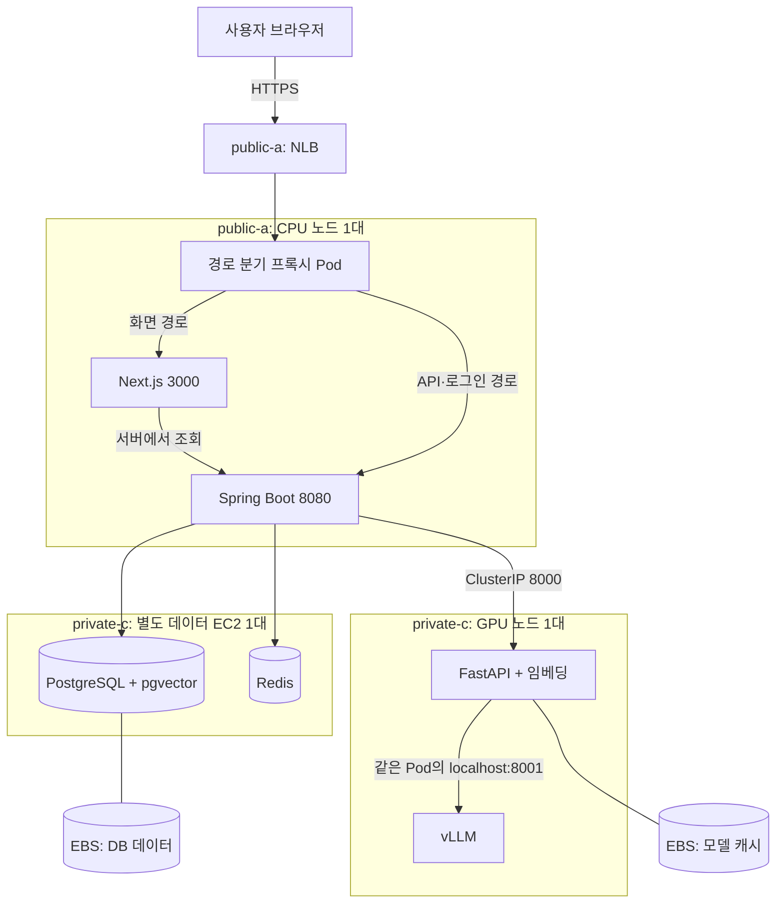

# nerdnam EKS 배포 계획

> **이전 설계 기록.** 현재 코드와 Argo CD·관측 도구를 반영한 계획은 [EKS · GitOps · 관측 구축 계획](EKS-GitOps-관측-구축계획.md)을 따른다. 아래 GPU 1대를 포함한 구성은 Bedrock 전환 전 내용이다. 2026-10-28 합의한 현재 배포안은 app/platform/data CPU EC2 3대를 모두 동일 EKS의 워커로 두고 Nova 2 Lite·Titan V2를 호출한다.

검토일: 2026-10-27 (한국 시간). 상태: 구현 전 계획. FE는 Amplify 대신 EC2로 배포한다. FE·BE용 CPU 1대, DB·Redis용 별도 CPU 1대, vLLM·임베딩용 GPU 1대의 총 3대로 구성한다. 자동 확장 없이 퍼블릭 서브넷 1개와 프라이빗 서브넷 1개를 사용한다. FE·BE는 같은 EKS CPU 노드에 배치하는 안으로 정리한다.

이번에는 저장소를 검토하고 구축 순서만 정리했다. Terraform 코드 작성·plan·apply와 AWS 리소스 조회·생성은 수행하지 않았다. AWS 계정의 실제 리소스, 예산, GPU 할당량·재고는 구현 단계에서 확인한다.

## 1. 저장소에서 확인한 내용

| 저장소 | 확인한 상태 | 배포에 미치는 영향 |
| --- | --- | --- |
| INFRA-nerdnam | `73ce3f3`. 서울 리전 AWS provider, S3 backend, `use_lockfile = true`, 공통 태그, 초기 확인용 리소스만 존재 | 현재 루트와 `dev/terraform.tfstate`를 유지하고 VPC부터 추가 가능 |
| BE-nerdnam | HEAD `ba7aade`, 별도 기능 브랜치에 미커밋 변경 있음. Java 21 / Spring Boot 4.1.1, Dockerfile·Compose, PostgreSQL·Redis·AI 연동 | 기존 작업을 보존. EKS 전용 실행 설정과 Service·Deployment 필요 |
| FE-nerdnam | 로컬 HEAD `09d237c`보다 원격 main `aeb2708`이 앞섬. 원격에 standalone Dockerfile·Compose가 이미 존재 | Dockerfile을 새로 만들 필요 없음. 최신 main 반영 후 ECR 빌드에 재사용 |
| AI-nerdnam | 로컬 `053d2d4`, 원격 `10ebbc7` 확인. 로컬 stub Docker 추가 후 취소되어 배포 관련 최종 차이 없음. FastAPI + 임베딩, vLLM 별도 이미지 | CPU 앱과 구분되는 GPU 노드·스토리지·시작 순서 필요 |
| SPEC-nerdnam | `39308a0`까지 fast-forward 동기화. ADR-0001·0005, 기획서 변경 이력 v1.57 확인 | 기존 EKS 결정과 이번 네트워크 요청의 차이를 기록해야 함 |

FE·AI·BE·INFRA는 fetch 후 원격 main도 검토했고 작업 파일을 갱신하지 않았다. BE의 미커밋 변경은 수정하지 않았다. SPEC 기획서 머리말은 v1.56이지만 변경 이력 최상단은 v1.57이다.

주요 근거 파일:

- INFRA: `backend.tf`, `providers.tf`, `versions.tf`, `.terraform.lock.hcl`.
- BE: `compose.yaml`, `Dockerfile`, `src/main/resources/application*.yml`, `member/auth/SecurityConfig.java`, `aijob/application/AiJobConfig.java`, DB 초기 마이그레이션.
- FE: 원격 main의 `Dockerfile`, `next.config.ts`, `src/shared/api/origin.ts`, `server.ts`.
- AI: `Dockerfile`, `docker-compose.yml`, `app/config.py`, `app/main.py`.
- SPEC: `adr/0001-gpu-model-serving.md`, `adr/0005-eks-serving.md`, `기획서.md`, `작업목록.md`.

## 2. 기존 결정과 조정할 부분

### 네트워크

사용자 요청에 따라 **퍼블릭 서브넷 1개 + 프라이빗 서브넷 1개 + NAT**로 변경한다. EKS 클러스터 생성에는 서로 다른 AZ의 서브넷 2개가 필요하므로 두 서브넷을 같은 AZ에 만들지 않는다. EC2 수와 EKS의 서브넷 요구사항은 별개다.

이 개수를 유지하는 배치안으로 FE·BE용 CPU 노드는 public-a, GPU 노드와 별도 데이터 EC2는 private-c에 둔다. 데이터 EC2는 EKS 노드로 편입하지 않는다. DB·Redis는 데이터 EC2의 프라이빗 주소로 연결하고 해당 포트를 인터넷에 열지 않는다.

기존에 제안한 인터넷 공개 ALB는 서로 다른 AZ의 퍼블릭 서브넷 2개가 필요하므로 제외한다. **public-a의 NLB → 같은 AZ CPU 노드의 경로 분기 프록시 → FE·BE**로 계획한다. NLB는 단일 서브넷을 지원하지만 URL 경로별 분기를 하지 않으므로 CPU 노드에 Traefik 같은 프록시 Pod 1개를 추가한다. 이는 EC2 추가가 아니다. 프록시 제품·설정은 배포 단계에서 확정한다.

NLB만 public-a에 두고 CPU를 private-c에 두는 방식을 단순 대체안으로 가정하지 않는다. NLB는 활성화된 AZ의 대상을 사용하며 cross-zone 옵션만으로 비활성 AZ 문제가 해소되지는 않는다. 이번 계획은 NLB와 CPU 대상의 AZ를 맞춘다.

근거: [EKS 서브넷 요구사항](https://docs.aws.amazon.com/eks/latest/userguide/network-reqs.html), [ALB 서브넷 요구사항](https://docs.aws.amazon.com/elasticloadbalancing/latest/application/application-load-balancers.html), [NLB 서브넷 구성](https://docs.aws.amazon.com/elasticloadbalancing/latest/network/availability-zones.html), [로드밸런서 AZ와 대상](https://docs.aws.amazon.com/elasticloadbalancing/latest/userguide/how-elastic-load-balancing-works.html).

구현 시 SPEC ADR-0005의 네트워크·서버 배치·Redis 위치·노드 관리·비용 부분도 함께 갱신한다. 현재는 인프라 계획 문서에 결정을 정리하고 기존 ADR은 아직 수정하지 않았다.

### 사용자 확정 배치와 자동 확장 범위

FE는 Amplify를 사용하지 않고 BE와 같은 CPU 인스턴스에서 별도 Pod로 실행한다. PostgreSQL·Redis는 별도 데이터 EC2에서 Docker Compose로 실행하는 안을 사용한다. GPU 인스턴스에는 vLLM·임베딩 서버를 배치한다. RDS는 사용하지 않는다. EKS CPU·GPU 두 노드 그룹의 목표 노드 수는 각각 1대이며, 데이터 EC2 1대는 Terraform으로 별도 관리한다. Karpenter·Cluster Autoscaler·HPA는 도입하지 않는다.

용어를 구분하면 HPA는 Pod 복제본 수를 조절하고, Karpenter·Cluster Autoscaler는 노드 용량을 조절한다. 이번 구성은 둘 다 자동으로 늘리지 않는다. Managed Node Group은 고정 목표 수의 EC2 서버를 관리하는 용도로 사용한다.

기존 ADR의 Karpenter 자동 생성·자동 종료는 이번 구현 범위에서 제외한다. 따라서 앞서 검토한 Karpenter의 GPU 슬롯 계산 제약도 이번 고정 노드 구성의 장애물이 아니다. GPU 한 장을 두 컨테이너가 공유하도록 하는 device plugin time-slicing 설정과 실제 동작 검증은 여전히 필요하다. 사용하지 않을 때 GPU를 끄는 기능은 별도 요청이 있을 때 정한다.

근거: [Kubernetes HPA](https://kubernetes.io/docs/tasks/run-application/horizontal-pod-autoscale/), [AWS GPU time-slicing](https://docs.aws.amazon.com/eks/latest/userguide/device-management-nvidia-time-slicing.html).

## 3. 권장 구성

개발 환경 하나부터 시작한다. 운영 환경은 state·클러스터·데이터를 별도로 분리한다.



EKS 컨트롤 플레인은 AWS가 관리한다. 클러스터 네트워크에는 public-a와 private-c를 모두 지정하고, 노드 그룹에는 각각 배치할 서브넷 하나를 지정한다. FE·BE용 CPU 노드는 퍼블릭 IPv4와 IGW를 통해 외부와 통신한다. GPU·데이터 EC2는 NAT를 통해 이미지·모델·업데이트를 다운로드하며 퍼블릭 IP를 부여하지 않는다. CPU 노드는 앱 포트를 직접 공개하지 않고 NLB에서 프록시로 들어오는 포트만 허용한다.

| 구성요소 | 첫 구축 제안 | 확장·제약 |
| --- | --- | --- |
| 리전 / AZ | ap-northeast-2 / public-a, private-c | GPU 인스턴스 지원·계정 할당량·실제 재고 확인 필요 |
| EKS | 일반 EKS + Managed Node Groups | 현재 요구에 필요한 GPU 플러그인 설정을 직접 관리. 버전·AMI·애드온 호환 조합은 구현 시 고정 |
| CPU 노드 | public-a의 Managed Node Group 1대, min=desired=max=1. FE·BE·프록시·클러스터 도구 배치 | 이 노드에는 DB·Redis를 설치하지 않는다. 인스턴스 사양은 앱 사용량으로 선정 |
| GPU 노드 | private-c의 별도 g4dn.xlarge 그룹 1대, min=desired=max=1 | 온디맨드, 캐시와 같은 AZ에 고정. T4 성능·메모리 부족 시 g6 후보 검토 |
| 데이터 EC2 | private-c의 별도 CPU EC2 1대. EKS 외부에서 PostgreSQL·Redis 실행 | 앱 배포와 독립된 수명·업데이트·백업 관리 |
| DB | 데이터 EC2의 PostgreSQL 17 + vector·pg_trgm 컨테이너 | 암호화된 데이터 EBS를 호스트에 마운트하고 컨테이너에 연결 |
| Redis | 데이터 EC2의 Redis 컨테이너 | 세션 저장에 사용. 기존처럼 재시작 시 재로그인 허용. AI 결과 캐시는 미구현 |
| 이미지 | ECR web / api / ai | vLLM도 검증한 태그·digest 고정. Git 커밋 기반 태그 사용 |
| 배포 설정 | apps/의 FE·BE·AI는 Kustomize, data/의 DB·Redis는 Compose | 앱 저장소는 이미지 빌드, 인프라 저장소는 AWS 리소스·배포 정의 담당 |

서브넷 두 AZ 구성 자체가 앱의 고가용성을 보장하지는 않는다. FE·BE용 CPU, 데이터용 CPU, GPU는 각각 한 대다. 앱 노드를 교체해도 데이터 EC2는 유지되지만 데이터 EC2 장애 시 PostgreSQL·Redis가 함께 중단될 수 있다. GPU 모델 캐시와 DB 데이터 EBS는 각각 AZ c의 서버에 연결한다. BE↔DB·Redis·AI 통신과 private-c→NAT 통신은 AZ를 가로지르므로 전송 비용을 반영한다.

현재 Compose와 같은 pgvector 포함 PostgreSQL 이미지 계열을 활용하고 배포할 이미지 버전을 고정한다. DB는 app·rag 스키마를 함께 사용하므로 별도 벡터 DB는 필요하지 않다. DB 데이터 EBS 암호화와 BE-17의 필드 암호화·개인정보 제거는 별개의 작업이다.

## 4. 바로 다음 마일스톤: VPC만 생성

다음 값은 제안값이다. apply 전에 계정의 기존 VPC, 향후 VPN·피어링, Kubernetes Service CIDR과 겹치지 않는지 확인한다.

| 용도 | AZ | CIDR | 인터넷 기본 경로 |
| --- | --- | --- | --- |
| VPC | — | 10.20.0.0/16 | — |
| public-a | ap-northeast-2a | 10.20.0.0/24 | Internet Gateway |
| private-c | ap-northeast-2c | 10.20.16.0/20 | public-a의 NAT Gateway |

각 서브넷에는 노드뿐 아니라 VPC CNI의 Pod IP도 할당된다. 클러스터 네트워크에는 위 두 서브넷을 등록하고, CPU·GPU 노드 그룹에는 각각 public-a·private-c를 지정한다. 데이터 EC2는 private-c에 별도로 생성한다. RDS DB subnet group은 만들지 않는다.

- VPC 1개, Internet Gateway 1개.
- Public Subnet 1개, Private Subnet 1개. 각각 서로 다른 AZ.
- dev는 public-a에 **AZ 단위 NAT Gateway 1개 + EIP 1개**를 제안한다.
- public 라우팅 테이블 1개, private 라우팅 테이블 1개: 총 2개.
- public의 `0.0.0.0/0`은 IGW, private의 `0.0.0.0/0`은 NAT로 연결한다. 같은 VPC 내 CPU↔GPU 통신은 local 경로를 사용한다.
- DNS support·hostnames 활성화. 앱용 public subnet은 Managed Node Group의 퍼블릭 IPv4 부여 조건을 충족하도록 설정하고 private GPU·데이터 EC2에는 퍼블릭 IP를 부여하지 않는다.
- 로드밸런서 검색용으로 public은 `kubernetes.io/role/elb=1`, private은 `kubernetes.io/role/internal-elb=1` 태그를 붙인다. 공개 NLB에는 public-a를 명시한다.
- 출력값은 `vpc_id`, AZ 목록, public/private subnet IDs, NAT Gateway IDs 등 다음 단계에서 쓸 값으로 구성한다.

GPU 노드는 다른 AZ의 NAT를 사용하므로 AZ 간 전송 비용이 생길 수 있다. public-a의 장애는 외부 접속·CPU 서비스와 GPU의 외부 통신에 영향을 준다. [AWS NAT 설명](https://docs.aws.amazon.com/vpc/latest/userguide/nat-gateway-basics.html).

완료 기준:

1. `terraform fmt -check`, `terraform validate` 통과.
2. 저장한 plan에서 의도한 네트워크 리소스만 추가되고 기존 state backend에 변경이 없음.
3. 검토한 plan을 적용한 뒤 CIDR·AZ·서브넷 태그·라우트·출력값을 확인.
4. 아직 노드가 없으므로 실제 Pod의 인터넷 통신은 EKS 단계에서 검증.

검증 시 EKS 클러스터용 두 서브넷의 AZ가 서로 다르고, CPU·GPU 노드 그룹의 배치 서브넷이 올바른지도 확인한다. 퍼블릭 서브넷 등록이 EKS API의 인터넷 공개 설정을 결정하지는 않으며 API endpoint 접근 정책은 별도로 설정한다.

## 5. 단계별 진행 순서

| 단계 | 작업 | 완료 기준 |
| --- | --- | --- |
| 1 | VPC·2개 서브넷·IGW·NAT·라우팅 | 위 네트워크 완료 기준 충족 |
| 2 | EKS + public-a의 CPU Managed Node Group, 팀원 access entries·IAM 권한 | 노드 Ready, CoreDNS·VPC CNI·kube-proxy 정상, CPU 노드에서 이미지 다운로드 가능 |
| 3 | EBS CSI·Pod Identity·AWS Load Balancer Controller·프록시·로그·Secret 공급 도구 | 테스트 PVC 연결, public-a의 NLB→CPU 프록시 연결, 앱별 최소 AWS 권한 확인 |
| 4 | ECR 3개·GitHub Actions OIDC·비밀값 준비, 별도 데이터 EC2·EBS·PostgreSQL·Redis 구성 | 이미지 push/pull, DB 확장, BE에서 데이터 EC2 프라이빗 주소로 DB·Redis 연결, 데이터 보존 확인 |
| 5 | CPU 노드에 FE·BE 배포, 우선 BE 내장 AI stub 사용 | Flyway, HTTPS와 실제 Google·카카오 로그인, 세션·CSRF, 일반 저장·조회 검증 |
| 6 | private-c의 GPU Managed Node Group·device plugin·AI Pod·모델 캐시 배포 | NAT를 통한 이미지·모델 다운로드, 두 컨테이너의 GPU 공유, 모델 ready, BE의 실제 AI HTTP 호출 성공 |
| 7 | 실제 모델 전체 흐름·성능·실패 복구 | 재구성→확정→검색→리포트→작성 방향, AI 재시작 시 캐시 재사용 검증 |
| 8 | 배포 자동화와 운영 보강 | 이미지 갱신·롤백, DB 백업 복구, 로그·비용 알림. 자동 확장 도입은 범위 밖 |

VPC 다음에는 먼저 CPU 노드까지 확인한다. GPU 그룹은 AI를 배포하는 단계에서 생성하고, 생성 이후에는 목표 1대를 유지한다. EKS에는 FE·BE·AI Pod를 각각 1개씩 배포한다. DB·Redis는 데이터 EC2에서 각각 컨테이너 하나로 운영한다. Amplify 배포는 진행하지 않는다. 인프라 구축 완료와 실제 AI 품질·응답 시간 목표 달성은 따로 판단한다.

## 6. 프로젝트에 맞춰 준비할 배포 설정

### FE·BE 주소와 로그인

- 같은 공개 도메인에서 NLB는 CPU의 프록시로 전달하고, 프록시가 `/api/*`, `/oauth2/*`, `/login/oauth2/*`를 BE로, 나머지 화면 경로를 FE로 전달한다. NLB에는 URL 경로별 분기 기능이 없다.
- HTTPS는 ACM 인증서를 사용하는 NLB TLS listener 등으로 구성하고, 프록시에서 BE에 전달하는 외부 HTTPS 정보·Host·쿠키 처리를 함께 검증한다. 프록시 Pod 1개는 CPU 노드에서 실행하며 별도 EC2는 추가하지 않는다.
- FE 서버 조회는 `http://api.nerdnam.svc:8080` 같은 내부 Service 주소를 쓴다.
- FE의 `API_ORIGIN`은 `rewrites()` 때문에 **빌드 시에도** 필요하다. 실행 환경변수만 바꾸면 모든 프록시 주소가 바뀐다고 가정하지 않는다. 초기에는 namespace·Service 이름을 고정하고 환경별 이미지 또는 런타임 프록시 개선을 이후 검토한다.
- 현재 FE의 rewrite에는 `/login/oauth2/code/*`가 없다. 위 프록시 경로로 콜백을 BE에 직접 전달한다.
- BE에 `SPRING_PROFILES_ACTIVE=prod`를 명시하고 운영 설정을 추가한다. 기본 local 프로필, 로컬 DB 시드, header 인증, SQL 파라미터 trace 로그가 적용되지 않는지 확인한다.
- 웹 주소·로그인 성공/실패 URL·OAuth callback을 실제 HTTPS 도메인으로 맞춘다. Google·카카오 콘솔의 callback 등록도 필요하다.
- 프록시 전달 헤더를 신뢰하는 범위를 정하고 Secure·HttpOnly·SameSite 쿠키와 CSRF를 브라우저에서 검증한다.

### DB·작업 종료

- PostgreSQL·Redis는 EKS 밖의 전용 데이터 EC2에서 Docker Compose로 운영한다. BE의 JDBC URL과 REDIS_HOST는 데이터 EC2의 프라이빗 주소 또는 내부 DNS 이름을 사용한다. 기존 localhost·Compose 서비스 이름을 그대로 사용하지 않는다.
- PostgreSQL 데이터는 암호화된 별도 EBS를 호스트에 마운트하고 컨테이너 데이터 경로에 연결한다. DB에는 Kubernetes PVC를 사용하지 않는다. EC2·Compose 재생성 시 기존 데이터 볼륨을 초기화하거나 삭제하지 않도록 수명·연결·삭제 정책을 설정한다.
- 컨테이너 재생성·데이터 EC2 재부팅 후 데이터가 보존되는지 확인한다. 정기 DB 백업과 서버 외부 보관 경로를 정하고 복구를 검증한다. EBS 영속 저장과 백업은 별개다. DB·Redis 각 1개이므로 유지보수 중 중단을 감수한다.
- Redis 메모리 상한을 정해 DB와의 메모리 경쟁을 제어하고, 세션을 재시작 후에도 유지할지는 별도 운영 요구가 생길 때 결정한다. 현재 계획은 재로그인을 허용한다.
- 초기 마이그레이션은 `vector`, `pg_trgm` 확장 생성을 포함한다. 확장 설치 권한과 스키마 권한을 사전 검증하고, 마이그레이션 계정과 앱 실행 계정을 분리한다.
- CPU 노드 라벨과 필수 node affinity로 FE·BE·프록시를 CPU 그룹에 고정한다. FE·BE·클러스터 도구의 자원 합계와 데이터 EC2의 DB·Redis 사용량을 별도로 측정해 두 CPU 인스턴스 사양을 각각 정한다.
- BE의 AI 작업은 DB에 상태를 남기지만 실행 자체는 프로세스 안의 스레드 풀이다. 재시작 후 작업을 자동 재개하는 영속 큐는 없다.
- 현재 종료 시 스레드 풀 대기는 30초, AI guide 읽기 제한은 120초다. Kubernetes 종료 유예만 늘려서는 부족하다. Spring 종료·실행기 대기·배포 전략을 함께 맞추고 진행 중 종료 시 실패·재시도 동작도 확인한다.
- BE 프로세스 liveness는 프로세스 상태, readiness는 서비스 가능 여부를 기준으로 설계한다. GPU가 꺼졌다는 이유로 BE 전체 트래픽을 차단하지 않는다.

### GPU

- GPU 그룹에 taint를 두고 AI만 toleration·node affinity로 배치한다. CPU 앱이 GPU 노드를 차지하지 않게 한다.
- EKS AL2023 NVIDIA AMI와 vLLM 이미지의 CUDA·드라이버 호환성을 확인하고 버전을 고정한다. 기존 compose의 vLLM은 `v0.32.0`이다.
- device plugin time-slicing으로 한 GPU를 2개 슬롯으로 노출하고, 네이티브 사이드카 vLLM과 AI 컨테이너가 각각 1개를 요청하도록 실증한다. 공유가 GPU 메모리를 분리해 주지는 않는다.
- vLLM startupProbe가 통과한 다음 FastAPI를 시작한다. vLLM이 먼저 GPU 메모리를 확보해야 한다.
- vLLM 8001은 Pod 내부만, AI 8000은 ClusterIP만 사용한다. AI 입력은 namespace·Pod 라벨을 함께 제한한 NetworkPolicy로 BE에 허용한다. VPC CNI의 NetworkPolicy 기능을 실제 활성화한다.
- 기존 계약대로 AI readiness는 `/health`의 HTTP 응답 기준을 유지한다. 모델 loading/error는 본문으로 BE에 전달하고, 별도 운영 점검에서 두 모델의 ready를 확인한다.
- EBS gp3 50Gi 캐시, 암호화·WaitForFirstConsumer·보존 정책을 설정한다. EBS 캐시의 AZ와 GPU 그룹 AZ를 맞춘다. 모델 캐시는 노드를 꺼도 비용이 남는다.
- AI Deployment는 `Recreate`, replicas 1. GPU 노드 그룹도 목표 1대로 고정한다. HPA·노드 자동 확장·GPU 자동 종료는 추가하지 않는다. GPU 노드 자체를 끄는 운영 방식은 별도 요청 시 계획한다.

### 권한·비밀값·배포 경로

- DB 비밀번호·OAuth client secret·HF_TOKEN은 이미지·Git·평문 tfvars에 넣지 않는다. Secrets Manager와 External Secrets Operator 등 공급 경로를 정하고 앱별 Secret으로 전달한다. Terraform이 비밀값 본문을 관리하면 state에도 남을 수 있다.
- EKS API는 private access를 켜고, 초기 public access는 팀원 공인 IP로 제한한다. [AWS endpoint 설명](https://docs.aws.amazon.com/eks/latest/userguide/cluster-endpoint.html).
- GitHub Actions OIDC는 AWS 권한을 제공하지만 제한된 Kubernetes API까지의 네트워크 경로를 만들어 주지는 않는다. 첫 단계는 Actions에서 ECR push까지, 배포는 허용된 팀원 환경에서 수행한다. 이후 내부 배포 실행기 또는 클러스터 내부 GitOps 방식 중 하나를 정한다.
- 데이터 EC2는 프라이빗에 두고 보안 그룹에서 앱 노드 측의 DB 5432·Redis 6379 연결만 허용한다. Pod NetworkPolicy로 FE의 DB·Redis 직접 접근은 막고 BE의 데이터 EC2 통신을 허용한다. 컨테이너 서비스도 프라이빗 인터페이스와 인증을 설정한다.
- 데이터 EC2는 SSM 등 관리 경로를 준비하고 DB·Redis 포트와 SSH를 인터넷에 공개하지 않는다. namespace 정책을 default deny로 설정한다면 DNS·FE→BE·BE→DB/Redis/AI·OAuth 및 모델 다운로드에 필요한 통신도 명시적으로 허용한다.

## 7. 코드 배치 제안

현재 backend 경로를 옮기는 작업 없이 시작한다. 공개 Terraform VPC·EKS 모듈은 호환성을 확인하고 버전을 고정해 사용한다. 별도 자체 Terraform 모듈 추상화는 아직 만들지 않는다.

```text
INFRA-nerdnam/
├── backend.tf, providers.tf, versions.tf  # 기존 유지
├── main.tf, outputs.tf                   # 기존 유지·확장
├── variables.tf                         # 리전·AZ·CIDR·노드 구성
├── network.tf                           # 다음 작업 범위
├── eks.tf, iam.tf, ecr.tf               # 이후 단계별 추가; Amplify·RDS 리소스 없음
├── data-ec2.tf                          # 데이터 EC2·보안 그룹·EBS·관리 권한
├── terraform.tfvars.example             # 비밀값 없는 예시; 실제 tfvars는 ignore
├── 20-platform/                         # 별도 state로 Helm 도구 설치
├── k8s/                                 # StorageClass·클러스터 정책 등
├── apps/{web,api,ai}/                    # Kustomize 배포 정의
├── data/                                # 데이터 EC2용 Compose·설치·백업 설정
└── docs/EKS-배포-계획.md
```

AWS 인프라 루트는 기존 `dev/terraform.tfstate`를 계속 사용한다. 클러스터에 의존하는 Helm provider는 이후 `20-platform/`의 별도 state key로 분리해, 클러스터 생성·삭제와 도구 설치의 의존성을 다룬다. 앱 배포 정의는 Kustomize로 관리한다.

## 8. 비용·검증 범위

기존 ADR의 비용표는 현재 제안의 총비용으로 사용할 수 없다. 데이터 EC2 1대가 추가되며, NAT·NLB·DB 데이터 EBS·백업·로그·ECR·전송 비용도 반영한다. 앱용 CPU에는 FE·BE·프록시가 올라간다. Amplify·RDS 비용은 없다. 계정 예산과 서울 리전 현재 단가를 구현 전에 확인한다.

- 상시 비용: EKS, FE·BE용 CPU 노드 1대, 데이터용 CPU EC2 1대, GPU 노드 1대, NAT·NLB·앱 노드의 퍼블릭 IPv4, DB·캐시 EBS, 로그 보관 등.
- 사용량 비용: NAT 처리량·AZ 간/인터넷 전송, 이미지·모델 다운로드·백업 보관 등.
- 이번 계획은 GPU도 생성 후 1대를 유지하므로 GPU 인스턴스 비용이 계속 발생한다.

이번 검토는 코드·설정·최신 원격 main과 공식 문서를 근거로 했다. 컨테이너 빌드, Terraform 원격 state 내용, 실제 AWS 배포, 브라우저 로그인, GPU 실측은 아직 검증하지 않았다.
