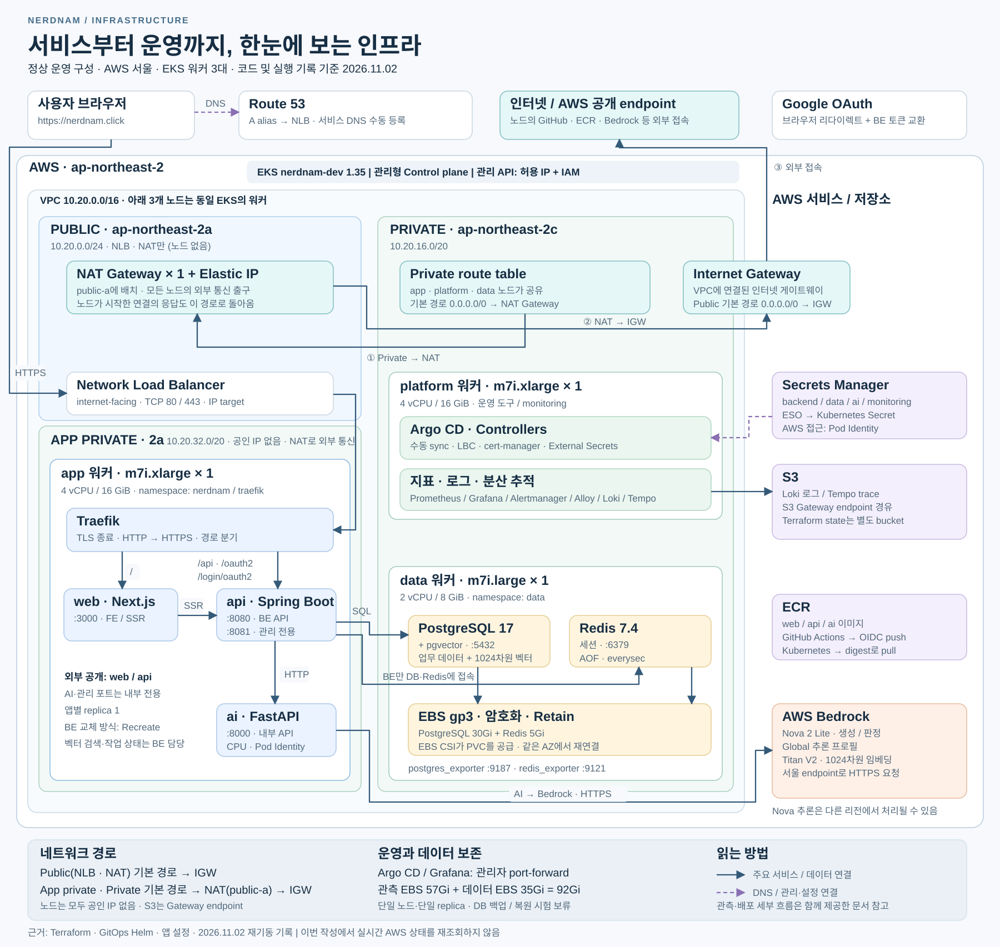
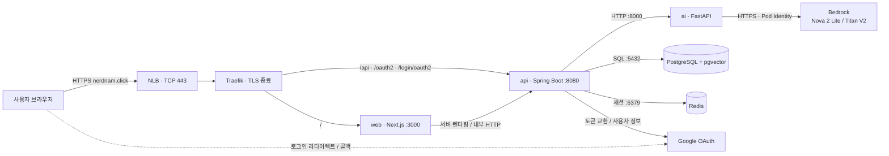
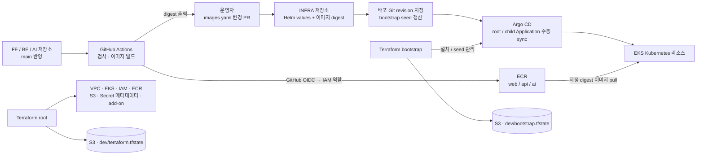
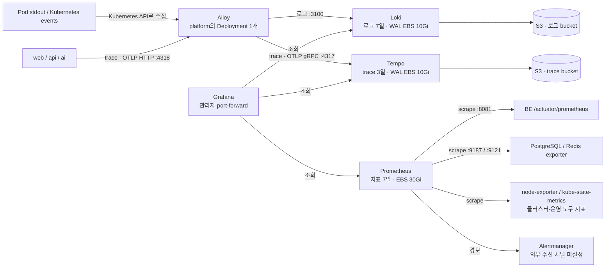

# nerdnam 인프라 아키텍처

작성일: 2026-11-02 · 코드 기준: INFRA `828e63a`와 로컬 FE·BE·AI 저장소.

이 구성도는 **정상 운영 시 워커 3대가 켜진 구조**를 나타낸다. Terraform·Helm 설정을 대조했고, 배포 여부는 `배포-runbook.md`의 2026-10-29~30 기록과 `운영-중지-재개.md`의 2026-11-02 재기동 기록을 근거로 삼았다. 이번 작성 과정에서 AWS·Kubernetes의 실시간 상태를 조회하지는 않았다. 초기 README·인수인계의 일부 ‘미배포’ 표기보다 최신 실행 기록을 우선한다.

## 1. 전체 구성도

- [확대·편집 가능한 SVG](architecture/nerdnam-infrastructure.svg)
- [공유용 PNG](architecture/nerdnam-infrastructure.png)
- [Mermaid 원본](architecture/nerdnam-infrastructure.mmd)

한 개의 AWS EKS 클러스터 안에서 **app / platform / data** 역할로 워커를 나눈다. FE·BE·AI는 app에, 운영·관측 도구는 platform에, PostgreSQL·Redis는 data에 배치한다. DB와 Redis도 Kubernetes Pod이며, AI는 FastAPI에서 AWS Bedrock을 호출한다.

| 영역 | 구성 | 역할 |
| --- | --- | --- |
| 공개 진입 | Route 53 → internet-facing NLB → Traefik | `nerdnam.click` 접속, HTTPS 종료, 경로 분기 |
| app 워커 | `m7i.xlarge` 1대 · 4 vCPU / 16 GiB | Next.js, Spring Boot, FastAPI, Traefik |
| platform 워커 | `m7i.xlarge` 1대 · 4 vCPU / 16 GiB | Argo CD, LBC, cert-manager, External Secrets, 관측 도구 |
| data 워커 | `m7i.large` 1대 · 2 vCPU / 8 GiB | PostgreSQL 17 + pgvector, Redis 7.4, DB/Redis exporter |
| 모델 호출 | AWS Bedrock | Nova 2 Lite: 생성·판정, Titan V2: 1024차원 임베딩 |
| 저장소 | EBS gp3, S3, ECR | 영속 디스크, 로그·trace·Terraform state, 컨테이너 이미지 |
| 인증·비밀값 | Google OAuth, Secrets Manager, EKS Pod Identity | 사용자 로그인, 비밀값 공급, Pod의 AWS 접근 권한 |

노드 그룹과 namespace는 다른 개념이다. `nerdnam` namespace의 web/api/ai는 app 노드에, `data` namespace는 data 노드에, `monitoring`과 여러 controller namespace는 platform 노드에 배치한다. Traefik은 `traefik` namespace에서 app 노드에 배치한다. node-exporter와 일부 EKS add-on은 여러 노드에 배치되므로 전체 그림에서는 생략했다. Argo CD 자체 Redis도 업무 세션용 Redis와 별개다.

## 2. 사용자 요청과 데이터 흐름

1. Route 53의 서비스 도메인 A alias가 NLB를 가리킨다. 이 DNS 레코드는 운영 기록상 수동 생성했다. DNS 조회는 이름 해석이며 HTTP 요청을 중계하는 프록시가 아니다.
2. NLB는 TCP 80/443을 Traefik Pod IP로 전달한다. HTTP는 HTTPS로 전환하고, **TLS 인증서는 Traefik에서 사용**한다. ALB·CloudFront·ACM을 경유하는 구조는 현재 코드에 없다.
3. Traefik은 `/api`, `/oauth2`, `/login/oauth2`를 BE로, 나머지 경로를 FE로 보낸다. FE의 서버 렌더링은 내부 Service 주소로 BE를 호출한다. 따라서 브라우저 API 요청이 항상 FE를 거치는 구조는 아니다.
4. BE가 업무 데이터·벡터 검색·사용자 세션·AI 작업 상태를 관리한다. AI 호출은 내부 FastAPI로 보내며, AI·FE가 PostgreSQL이나 Redis에 직접 접속하는 경로는 NetworkPolicy에서 허용하지 않는다.
5. AI는 생성·판정에 `global.amazon.nova-2-lite-v1:0`, 임베딩에 `amazon.titan-embed-text-v2:0`을 사용한다. 서울 리전으로 요청하지만 Nova는 **Global 추론 프로필**이므로 추론 위치를 서울 내부로 한정해 그리지 않았다.

Redis는 현재 로그인 세션 저장에 사용한다. AI 결과 캐시와 영속 메시지 큐는 구현돼 있지 않다. AI 작업 실행은 BE 프로세스 내부에서 이루어지고 상태는 DB에 남긴다. Kakao OAuth는 코드에 있지만 마지막 배포 기록에는 키 미설정으로 사용하지 않는다고 되어 있어, 구성도에서 Google만 운영 경로로 표시했다.

## 3. 네트워크와 접근 범위

| 구역 | CIDR / AZ | 배치 및 경로 |
| --- | --- | --- |
| VPC | `10.20.0.0/16` | 서울 `ap-northeast-2` |
| Public subnet | `10.20.0.0/24` · `ap-northeast-2a` | NLB, NAT Gateway(노드 없음) · 기본 경로 → IGW |
| App private subnet | `10.20.32.0/20` · `ap-northeast-2a` | app 노드(공인 IP 없음) · 기본 경로 → public-a NAT → IGW |
| Private subnet | `10.20.16.0/20` · `ap-northeast-2c` | platform·data 노드 · 기본 경로 → public-a NAT → IGW |
| S3 Gateway endpoint | 두 route table에 연결 | S3 접근 경로 · Loki/Tempo 객체 저장 등에 사용 |
| EKS API | private 활성화 + public CIDR 제한 | 관리자 IAM 권한과 허용 IP로 접근 |

전체 구성도 상단에 **public-a의 NAT Gateway + Elastic IP**, **Private route table**, **VPC에 연결된 Internet Gateway**를 표시했다. Private 노드가 GitHub·ECR API 등 외부 목적지로 연결할 때의 기본 경로는 `Private → NAT → IGW → 외부`다. 노드가 시작한 연결의 응답도 같은 경로로 돌아온다. 사용자 요청을 받아 Traefik으로 전달하는 NLB는 이 경로와 별개다. VPC 내부 서비스 통신과 S3 Gateway endpoint를 사용하는 S3 통신은 NAT를 거치지 않는다.

노드는 모두 private 서브넷에 있고 공인 IP가 없다. 인터넷에서 노드로 직접 들어오는 경로는 없고, 사용자 요청은 public 서브넷의 NLB를 거쳐서만 Traefik에 닿는다. app 노드(ECR 이미지, Bedrock, Google OAuth)를 포함한 모든 노드의 인터넷 통신은 NAT Gateway를 거친다. app private 서브넷을 public과 같은 2a에 둔 이유는 인터넷 공개 NLB가 자기 서브넷 AZ의 대상에만 요청을 보낼 수 있기 때문이다. 이 서브넷은 EKS 클러스터 서브넷 목록에 넣지 않았다(노드 서브넷은 같은 VPC면 된다). 2026-11-02 이전에는 app 노드가 public 서브넷에서 공인 IP로 IGW를 직접 썼다. Pod의 외부 통신에는 VPC CNI의 기본 SNAT 동작을 전제로 하며, 별도 SNAT 변경 설정은 저장소에서 확인되지 않았다.

- `nerdnam`·`data` namespace는 기본 수신·송신 차단 위에 DNS와 필요한 연결을 허용한다. platform 전체가 같은 수준으로 차단됐다고 해석하면 안 된다.
- 공개 서비스는 Traefik 뒤 FE/BE다. AI·DB·Redis·BE 관리 포트 `8081`은 공개 Ingress에 없다.
- Argo CD와 Grafana는 ClusterIP이며 관리자가 `kubectl port-forward`로 접근한다.
- `workload` 노드 라벨과 platform/data의 `dedicated:NoSchedule` taint로 배치 역할을 나눈다.
- EKS control plane은 AWS 관리형이다. EC2 워커 3대 중 하나에 설치하는 구조가 아니다.

## 4. CI/CD와 인프라 관리

앱 CI는 이미지를 ECR에 올리는 데까지 수행한다. INFRA의 `gitops/apps/images.yaml`은 운영자가 PR로 갱신한다. Argo Application은 지정된 `gitRevision`을 읽으므로 현재 운영 방식처럼 commit SHA를 고정하면 배포 revision 갱신도 필요하다. PR merge만으로 클러스터가 자동 배포되는 구조가 아니다. 자동 sync/prune 설정은 없으며 운영자가 순서에 맞춰 sync한다.

| 관리 주체 | 관리 대상 |
| --- | --- |
| Terraform root | VPC, EKS/MNG/add-on, IAM/Pod Identity, ECR, 관측 S3, Secrets Manager 메타데이터 |
| Terraform bootstrap | Argo CD Helm release, GitOps seed와 배포 revision |
| Argo CD | 앱·데이터·관측·controller의 Kubernetes 리소스 |
| AWS Load Balancer Controller | Traefik LoadBalancer Service에 대응하는 NLB |
| EBS CSI Driver | PVC에 대응하는 EBS 볼륨 |
| cert-manager | Let's Encrypt 인증서, Route 53 DNS01 검증 |
| External Secrets Operator | Secrets Manager → Kubernetes Secret, 1시간 갱신 주기 |

BE는 replica 1 + `Recreate`로 교체한다. 배포 전에 관리 포트에서 AI 신규 작업 접수를 중단하고 진행 중 작업을 비운다. 이때 일반 API readiness는 유지하며, 실제 Pod 교체 중에는 API 중단 구간이 있다.

## 5. 지표·로그·분산 추적

지표는 Prometheus가 가져오고, 로그와 trace는 Alloy가 받아 각각 Loki·Tempo로 전달한다. Alloy는 노드마다 있는 DaemonSet이 아니라 **platform 노드의 단일 Deployment**이며 Kubernetes API로 Pod 로그를 읽는다. Grafana에서 `trace_id`를 이용해 로그와 trace를 오갈 수 있다. 앱 OTLP 전송 대상은 trace이며 지표 중복 전송은 꺼져 있다.

## 6. 저장·비밀값·운영 한계

| 저장 대상 | 저장 위치 | 설정 |
| --- | --- | --- |
| 업무 데이터·벡터 | PostgreSQL PVC 30Gi | pgvector, SQL·벡터 검색은 BE 수행 |
| 사용자 세션 | Redis PVC 5Gi | AOF, `appendfsync everysec` |
| 지표 | Prometheus PVC 30Gi | 7일, 크기 제한 20GB |
| Grafana / Alertmanager | PVC 5Gi / 2Gi | 대시보드 관련 데이터 / 알림 상태 |
| 로그 | Loki S3 + PVC 10Gi | S3 chunk/index, PVC WAL, 7일 보관 |
| trace | Tempo S3 + PVC 10Gi | S3 trace block, PVC WAL/live-store, 3일 보관 |
| Terraform state | 별도 S3 backend | root·bootstrap의 key 분리 |

위 7개 PVC는 총 92Gi이며 노드 루트 디스크는 별도다. StorageClass는 암호화된 `gp3-retain`, `WaitForFirstConsumer`, `Retain` 정책이다. EBS는 해당 AZ에 연결되므로 워커를 다시 올릴 때 같은 AZ의 새 노드에 재연결한다. Loki·Tempo bucket의 S3 lifecycle은 각각 28일·12일로, 애플리케이션 보존 기간보다 긴 정리 안전망이다.

Secrets Manager의 backend/data/ai/monitoring 항목을 External Secrets가 필요한 Kubernetes Secret으로 옮긴다. BE는 DB 런타임 계정과 Flyway migration 계정을 분리한다. AI의 Bedrock 접근은 `nerdnam/ai` ServiceAccount에 연결된 Pod Identity를 사용한다. AI용 Secret 선언은 있지만 현재 AI Deployment는 그것을 참조하지 않는다.

현재 구성의 운영 범위:

- 역할별 워커 1대, 앱·DB·Redis 각 replica 1로 **고가용성 구성이 아니다**. 2c 장애는 platform과 data에 함께 영향을 준다. NAT도 1개다.
- PostgreSQL S3 일일 백업·새 PVC 복원 시험은 보류 상태다. EBS Retain은 삭제 방지 정책이며 백업을 대신하지 않는다.
- Alertmanager 외부 알림 수신 채널은 아직 설정되지 않았다.
- 비용 절감을 위해 세 노드 그룹을 0으로 줄일 수 있다. 그동안 서비스와 관측은 중단되고 EKS 제어부·NAT·NLB·EBS·S3 등은 유지된다.
- 최신 저장소 기록(2026-11-02)은 노드 3대 재기동, 15개 Argo Application 정상, 같은 PVC 볼륨 재연결과 데이터 유지 확인을 남겼다. 이는 기존 실행 기록이며 이번 작업의 실시간 점검 결과는 아니다.

## 7. 구성 근거

| 확인 항목 | 근거 파일 |
| --- | --- |
| 서브넷·라우팅·S3 endpoint | [network/main.tf](../modules/network/main.tf) |
| EKS·노드 배치·ECR·add-on | [eks/main.tf](../modules/eks/main.tf), [variables.tf](../variables.tf) |
| 공개 경로·TLS·포트 | [ingress.yaml](../gitops/apps/templates/ingress.yaml), [traefik.yaml](../gitops/root/configs/traefik.yaml) |
| 앱 연결·replica·배포 전략 | [workloads.yaml](../gitops/apps/templates/workloads.yaml), [apps/values.yaml](../gitops/apps/values.yaml) |
| 허용 통신 | [앱 NetworkPolicy](../gitops/apps/templates/network-policy.yaml), [데이터 NetworkPolicy](../gitops/data/templates/network-policy.yaml) |
| 데이터·볼륨·exporter | [data/values.yaml](../gitops/data/values.yaml), [foundation.yaml](../gitops/foundation/templates/foundation.yaml) |
| AWS 인증·모델·CI 역할 | [workload/main.tf](../modules/workload/main.tf) |
| Secret 공급 | [external-secrets.yaml](../gitops/secrets/templates/external-secrets.yaml), [platform/main.tf](../modules/platform/main.tf) |
| GitOps·revision·수동 sync | [applications.yaml](../gitops/root/templates/applications.yaml), [bootstrap/main.tf](../bootstrap/main.tf) |
| 관측·보관 기간 | [관측 설정 디렉터리](../gitops/root/configs), [observability/main.tf](../modules/observability/main.tf) |
| FE→BE 내부 호출 | [FE next.config.ts](../../FE-nerdnam/next.config.ts), [FE workflow](../../FE-nerdnam/.github/workflows/image.yaml) |
| 앱 CI | [BE workflow](../../BE-nerdnam/.github/workflows/push-image.yml), [AI workflow](../../AI-nerdnam/.github/workflows/ci.yml) |
| AI 모델·벡터 차원 | [AI config.py](../../AI-nerdnam/app/config.py) |
| 실제 배포·공개·관측 확인 이력 | [배포 runbook](배포-runbook.md), [운영 중지·재개](운영-중지-재개.md) |
